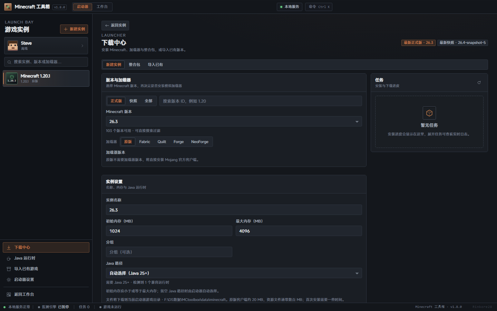

# Launch Bay · 内置启动器

v1.8.0 在主菜单新增独立的 Minecraft 启动器。它和工作台是同级页面：启动器默认打开，工作台通过标题栏「工作台」或 `Ctrl/Cmd+2` 进入，原有八个功能、设置页、数据目录与接口全部保留。

## 1. 页面结构

```
标题栏  品牌 · 启动器/工作台 · 本地服务 · 命令
┌───────────────┬──────────────────────────────────────────────┐
│ 账户卡          │ 实例主面板                                      │
│ 搜索            │ 图标 / 名称 / 版本 / 账户 / 启动 · 停止           │
│ 实例列表        │ 最后游玩 · 时长 · 内存 · Java · 目录             │
│                 │ 概览 / 模组 / 资源包 / 光影 / 世界 / 截图 / 服务器 / 日志 │
│ 下载/Java/导入  │ 概览：启动配置、实例信息、内容统计、最近日志、崩溃诊断、版本动态 │
│ 设置/返回工作台  │                                                │
└───────────────┴──────────────────────────────────────────────┘
状态栏  本地服务 · 监测引擎 · 任务 · 游戏运行状态 · 版本 · 作者
```

- 实例列表按最近启动排序，可搜索名称、版本、加载器与分组；双击直接启动。
- 启动器页面的「下载中心」包含：新建实例、整合包、导入已有、任务队列。
- 「Java 运行时」页负责扫描、设默认、指定 `java.exe` 与下载 Temurin 8–25。
- 实例设置弹窗覆盖名称、分组、内存、窗口、全屏、自动进服、Java、JVM/游戏参数与备注。
- 命令面板新增「启动器」分组，可在任意页面启动/停止当前实例、打开账户、Java、设置与实例目录。

## 2. 功能范围（参考 HMCL / PCL2 / Prism 的常用能力）

| 能力 | 实现 |
| --- | --- |
| 原版安装 | Mojang 版本清单 + 客户端 JAR + libraries + assets（含旧版 virtual / map_to_resources） |
| 加载器 | Fabric、Quilt（profile JSON）；Forge、NeoForge（官方 installer `--installClient`，安装器依赖可走 BMCLAPI 镜像） |
| 下载源 | 自动（BMCLAPI 优先、失败回退官方）、官方、BMCLAPI；并发/重试/校验可配置 |
| 进度与取消 | 真实字节数、资源文件计数、Phase、日志；任务可取消并清理临时文件 |
| 实例 | 创建/编辑/复制/删除/导入已有；内存、Java、窗口、全屏、服务器、JVM/游戏参数 |
| 账户 | 离线（OfflinePlayer UUID）、微软设备代码 OAuth（内置公共客户端，也可填自己的 Azure ID）、authlib-injector 第三方 |
| 启动 | 版本继承、OS/arch 规则、Modern/legacy 参数、natives、日志配置、Forge ModLauncher |
| 日志 | stdout/stderr 实时捕获（log4j XML 转可读文本）、已保存日志、崩溃报告与中文诊断 |
| 模组 | JAR 拖入/选择、启停、删除、重复/缺失前置提示、Modrinth / CurseForge 搜索安装；按文件 SHA-1 检查 Modrinth 更新并解析缺失前置 |
| 资源包 / 光影 | ZIP 导入、启停（写 options.txt）、删除、打开目录 |
| 世界 / 截图 | 世界卡片（版本/模式/大小/时间）、截图缩略图与大图、删除/打开目录 |
| 服务器 | 读写 `servers.dat`、添加/删除、一键设为启动后自动连接 |
| 整合包 | Modrinth `.mrpack`、CurseForge ZIP；识别 MC/加载器、安装加载器、补文件、解压 overrides |
| 下载中心 | 实例安装/整合包/修复/模组更新任务与社区资源下载统一展示，支持取消与清理记录 |
| JVM 优化 | 一键写入 Aikar 风格 G1 参数，只合并 GC 参数、不改动 `-Xms`/`-Xmx` |
| 迁移 | 扫描标准 `.minecraft/versions`（官方 / PCL2 / HMCL），引用原目录不复制 |
| Java | 本机扫描（含官方启动器 runtime）、真实 `java -version` 校验、Temurin 下载、默认 Java |
| 启动器设置 | 游戏目录、下载源、并发、重试、校验、默认内存/窗口、参数、Java、微软 Client ID、行为 |

### 未实现 / 边界

- **OptiFine**：不做自动安装器（官方安装器依赖 GUI，且需要向游戏 JAR 注入补丁）。两条可用路径：在 Forge 实例中把 OptiFine JAR 放入 `mods/`；或先用原启动器安装，再用「导入已有」。不新增自动下载，避免分发第三方闭源文件。
- **微软登录**：默认使用内置公共客户端（PCL/HMCL 同款 Live Connect 设备码），无需注册 Azure 应用；也可在「启动器设置 → 账户」填写自己的 Azure 公共客户端 ID 覆盖。令牌刷新会自动沿用登录时的流程。
- **Prism 实例**：只支持标准 `.minecraft/versions` 布局。Prism 实例的 `mmc-pack.json` + `patches/*.json` 需要现场合成版本 JSON；若写入原 `.minecraft/versions` 会破坏「只引用不修改原目录」的约定，因此本轮不实现，继续建议先用 Prism 导出/复制为标准版本后导入。
- **皮肤**：只展示账户档案自带的皮肤（微软/第三方），不提供上传或本地皮肤仓库。
- **CurseForge**：使用官方 API Key（设置中已有）或 curse.tools 公共元数据；作者禁止自动下载时给出文件名与手动处理步骤，若本地已有 SHA-1 一致的文件会直接复用。
- **资源包启停**：直接修改 `options.txt`；游戏运行中修改可能被游戏覆盖。
- **旧版 Forge 安装器**：通过官方 installer 运行；需要对应 Java（1.12.2 → Java 8）。安装器失败时会保留完整日志。

## 3. 数据目录

启动器根目录默认是运行数据目录下的 `minecraft/`：

```
<root>/
  versions/<versionId>/<versionId>.json|.jar
  libraries/…
  assets/indexes/*.json
  assets/objects/<xx>/<hash>
  assets/log_configs/client-*.xml
  assets/virtual/<indexId>/…            # 旧版资源
  cache/installers/…                    # Forge/NeoForge 安装器缓存
  cache/authlib-injector/…              # 第三方登录 agent
  cache/packs/<jobId>/                  # 整合包临时目录
  instances/<instanceId>/
    game/                               # 隔离游戏目录（mods/saves/options.txt…）
    logs/launch-*.log                   # 启动器捕获日志
    natives/<jarVersion>/               # legacy natives 解压目录
```

配置文件：

- `launcher.json`（配置目录）：启动器设置 + 实例清单 + 选中实例。
- `launcherAccounts.json`（配置目录）：账户与令牌；Windows 下尝试 `chmod 600`。API 只返回脱敏字段，令牌不会进入前端或日志。
- 外部导入实例：`baseDir` 指向原 `.minecraft`，`gameDir` 可能是隔离版本目录；日志/natives 仍存放在启动器实例目录，删除实例不会删除原目录。

## 4. 关键实现

### 4.1 版本继承与规则

`src/server/launcher/launch-plan.js` 是纯函数层：

- `rulesAllow`：OS 名称、arch、version 正则、features；按顺序应用 allow/disallow。
- `combineVersions`：子版本覆盖标量；libraries 去重（子优先）；JVM/game 参数拼接；Forge 的空 `logging` 不会清除父版本日志配置。
- `libraryArtifacts`：优先 `downloads.artifact`，否则按 Maven 坐标构造 URL；legacy `natives` 分类器单独提取；现代 natives JAR 进 classpath。
- `buildLaunchPlan`：内存 → 用户 JVM → 版本 JVM；补 `-cp` 与 `-Djava.library.path`；日志配置；游戏参数、尺寸、服务器、自定义参数；离线/微软/第三方账户占位符。
- Forge 修复：将实际客户端 JAR 文件名追加到 `-DignoreList`，避免 ModLauncher 把 `1.20.1.jar` 当作自动模块导致 `module minecraft contains package ...`。
- `analyzeCrash`：OOM、Java 版本、NoSuchMethod/NoClassDef、 ModResolution、OpenGL、权限、网络等中文诊断。

### 4.2 安装

`src/server/launcher/install.js`：

1. 取版本清单与版本 JSON，写 `versions/<mc>/<mc>.json`，下载客户端 JAR 与日志配置。
2. Fabric/Quilt：取 profile JSON，改写 `id` 为自定义版本 ID；Forge/NeoForge：下载官方 installer，写 `launcher_profiles.json`，优先使用本机较高的兼容 Java 运行安装器，读取 `version.json` 确定生成的版本 ID。
   - NeoForge 1.20.1 发布在 `net.neoforged:forge` 坐标（版本形如 `1.20.1-47.1.106`），1.20.2+ 才使用 `net.neoforged:neoforge`；`forgeInstaller()` 会按 MC 版本选择正确坐标与 `expectedId`。
   - 非官方源时安装器本身从 BMCLAPI 下载，并预取 `version.json` / `install_profile.json` 中声明的全部库；`mirrorUrl()` 同时把 `maven.neoforged.net` / `maven.minecraftforge.net` 映射到 BMCLAPI。这样即使原 maven 被 DNS 污染或超时，安装器也能完成。
3. `loadVersionChain` 合并继承链，按当前 OS 规则下载全部 libraries（含 natives）；asset index 与 objects 按 SHA-1 校验，支持镜像回退。
4. 写 `.mc-toolbox-installed` 标记并更新实例 `installedAt`；修复任务复用同一套文件检查/下载逻辑。
5. 任务由 `InstallJob` 管理：真实进度、日志环形缓冲、取消（AbortController + 杀安装器进程）、失败清理、完成后刷新实例。

### 4.3 启动

`src/server/launcher/launch.js`：

- 校验实例/账户/Java；`prepareNatives` 只对 legacy natives 解压，并用签名文件避免重复解压。
- 在 `<instance>/logs/launch-*.log` 留存捕获日志；stdout/stderr 同时进入内存环形缓冲供前端增量轮询。
- log4j XML 事件行转换为 `[LEVEL] message`，异常堆栈原样输出。
- 用户主动停止标记 `stopping`，退出状态记为 `stopped`，不误报崩溃；强制结束使用进程树清理。
- 启动前验证 classpath 中的客户端 JAR、libraries、natives 是否存在，缺失时提示「检查并修复文件」。
- Java 发现会解析 `java.home`，避免 Oracle `javapath\java.exe` 垫片导致停止时留下孤儿进程。

### 4.4 账户

`src/server/launcher/accounts.js`：

- 离线：`UUID.nameUUIDFromBytes("OfflinePlayer:"+name)` 兼容算法；随机 accessToken。
- 微软：设备码 → MS token → XBL → XSTS → Minecraft services → profile；保存 refresh token，启动前 5 分钟内自动刷新；XErr 映射为中文提示。未配置 Azure ID 时使用内置公共客户端 `00000000402b5328` 走 Live Connect 设备码；配置后走 Azure v2 设备码。`msFlow` 随账户保存，刷新时沿用同一端点。
- 第三方：authlib-injector / Yggdrasil `/authserver/authenticate`、`validate`、`refresh`；启动时下载并校验 SHA-256 的 agent，添加 `-javaagent`。
- 令牌存储本地；API 仅返回 id/type/name/uuid/皮肤/到期等。

### 4.5 整合包

`startPackInstall`：

- 读取 `modrinth.index.json` 或 CurseForge `manifest.json`，推断 MC、加载器与版本。
- 安装基础版本/加载器后，解压 overrides/client-overrides 到实例游戏目录；Modrinth 按路径/哈希下载，CurseForge 按项目/文件 ID 补齐并校验 SHA-1。
- CurseForge 文件被作者禁止自动下载时，先查缓存、`mods/`、`resourcepacks/`、`shaderpacks/` 中是否有 SHA-1 一致的文件；命中则复用，否则错误信息列出 `项目/文件（文件名）` 并提示用官方启动器或手动下载。
- 记录 `.mc-toolbox-pack.json`；任务失败/取消时清理临时目录和上传文件。

## 5. 接口

完整列表见 README「常用 API」。核心前缀 `/api/launcher`：

- `bootstrap` / `settings` / `status` / `sessions`
- `instances` CRUD、`select`、`repair`、`launch`、`stop`、`preview`、`status`、`log`、`crash`
- `instances/:id/content?type=mods|resourcepacks|shaderpacks|worlds|screenshots|servers|logs|summary`
- `instances/:id/upload`（原始字节 + `X-File-Name`）、`mods/toggle`、`mods/delete`、`content/delete`、`resourcepack`、`servers`
- `instances/:id/mods/updates`、`mods/update`、`mods/missing`（Modrinth 更新检查 / 缺失前置）
- `versions`、`loaders/:loader/versions`、`install`、`jobs`、`packs/install|upload|inspect`
- `java`、`java/required`、`accounts/*`（离线/微软/authlib/select/refresh/delete）
- `import/scan`、`import`、`news`

文件型接口（如截图）会直接写响应，`requestHandler` 在 `res.writableEnded` 时跳过 JSON 包装。

## 6. 验证记录

验证环境：Windows 10 x64、Node 22.18、Edge 155（CDP headless）、Java 17.0.2；日期 2026-10-21。

### 6.1 自动化测试

- `node --test tests/*.test.mjs` 全绿。
- `tests/launcher-plan.test.mjs`：规则、版本继承、Maven 路径、natives、参数替换、Forge ignoreList、离线 UUID、IPv6、Java 版本、崩溃诊断。
- `tests/launcher-meta.test.mjs`：BMCLAPI 映射（含 NeoForge / Forge maven）、源回退链、NeoForge 1.20.1 `net.neoforged:forge` 坐标与 1.20.2+ 坐标、authlib 地址归一化、离线名校验。
- `tests/curseforge-pack.test.mjs`：文件 ID 固定、缓存校验、禁止自动下载的可操作错误文案、本地同 SHA-1 文件复用。

### 6.2 构建与 EXE

- `node build.mjs` 成功：`dist/mc-toolbox.exe` 82.5 MB；esbuild 552.1 KB；public.tar.gz 218.8 KB；host.exe + WebView2 DLL 267.3 KB；SEA blob 1391.3 KB。
- `src/server/integrity.gen.js` 包含 36 个壳文件，其中 11 个 `js/launcher/*.js` 与 `css/launcher.css`；`src/server/asset-version.gen.js` 指纹随 public 变化更新。
- 构建脚本的隔离冒烟测试通过：EXE 启动、`/api/bootstrap` 功能列表、首页作者水印与完整性校验。
- 手工启动 EXE（隔离 LOCALAPPDATA + `--no-open --port`）后，启动器 bootstrap/settings/instances/accounts/status、静态 `js/launcher/index.js` 与 `css/launcher.css` 均返回 200；页面切换、设置读取正常。

### 6.3 账户与登录

- 微软（内置公共客户端，Live Connect 设备码）：使用真实微软账户完成设备码登录；返回 UUID、皮肤、披风；`/accounts/:id/refresh` 成功轮换 accessToken/refreshToken；`launch` 后日志出现 `Setting user:` 与真实档案名，主菜单正常。API 响应不含 `accessToken` / `refreshToken`，界面与日志均只显示脱敏字段。
- authlib-injector：用 `tools/mock-yggdrasil.mjs` 自建 Yggdrasil（`/authserver/authenticate|validate|refresh` + `/sessionserver/...` + PNG 皮肤）。启动器登录、刷新、启动均通过；日志出现 `authlib-injector 1.2.8` / `Setting user: TestSkin`，游戏进入测试世界后向 mock 服务器请求了 `/skin.png` 与 `/cape.png`，确认皮肤链路生效。
- 令牌未出现在 API 响应、任务日志与启动日志中；启动命令预览中的 `--accessToken` 为 `<access token>`。

### 6.4 NeoForge 1.20.1

- 通过启动器 API 安装 `1.20.1 + NeoForge 47.1.106`。当前网络无法解析/连接 `maven.neoforged.net`；改用 BMCLAPI 安装器 + 预取 version/install_profile 依赖后安装成功，生成版本 `1.20.1-forge-47.1.106`。
- 启动到主菜单：日志有 `NeoForge v47.1.106 Initialized`、纹理图集与声音引擎完成；停止后 `tasklist` 无 `java.exe`。

### 6.5 整合包与模组

- Modrinth：安装真实 `.mrpack`「FPS Modpack 1.8」（Fabric 0.15.10 / 1.20.1）成功，12 个模组与 overrides 就位；另通过 `/api/community/download` 安装真实 Sodium 模组并校验大小。
- CurseForge：用官方 API Key 读取「Fabulously Optimized 5.4.1」（Fabric 0.14.23 / 1.20.1）；先验证 2 个作者禁止自动下载的文件会给出包含文件名与手动处理步骤的错误文案，再把手动取得的同 SHA-1 文件放入缓存，安装成功，46 个文件全部就位。
- `tests/curseforge-pack.test.mjs` 同时覆盖「作者禁止下载」和「本地同 SHA-1 文件复用」两条路径。

### 6.6 回归检查

- 启动器 / 工作台切换、命令面板（含「启动器」分组与搜索）、下载中心视图、900px 窄窗无横向溢出、亮色主题、启动器设置读取（默认内存 4096 / Microsoft OAuth 字段）均通过 `tools/launcher-ui-smoke.mjs`（CDP 截图 7 张，18/18 断言）。
- 后台状态栏：启动游戏后显示「游戏运行中 · Minecraft 1.20.1」，停止后恢复。
- 任务取消：安装 1.21.1 中途取消，任务状态 `cancelled`，无残留安装器进程。
- 外部实例删除：导入临时 `.minecraft` 后删除启动器实例，`removed=false / external=true`，原目录与标记文件仍在。
- 资源包 `options.txt` 写回：启用写入 `file/TestPack.zip`，禁用后移除，`version`、`lang` 等其他行保持不变。
- 全程结束 `tasklist` 无遗留 `java.exe`。

### 6.7 未做真实验收

- OptiFine：结论是不补自动安装器（需要 GUI/补丁注入，且涉及闭源分发）；保留 Forge `mods/` 与「导入已有」两条路径，已写入边界说明。
- Prism `mmc-pack.json`：结论是本轮不补。现场合成版本 JSON 需要写入原 `.minecraft/versions`，与「引用原目录、不改原目录」冲突；继续建议先导出为标准版本后导入。

## 7. 截图

暗色：总览、下载中心、Java 运行时、账户、启动器设置；亮色：总览。





