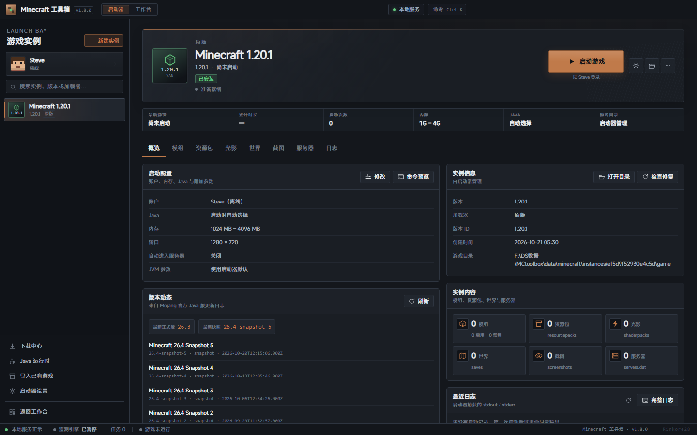
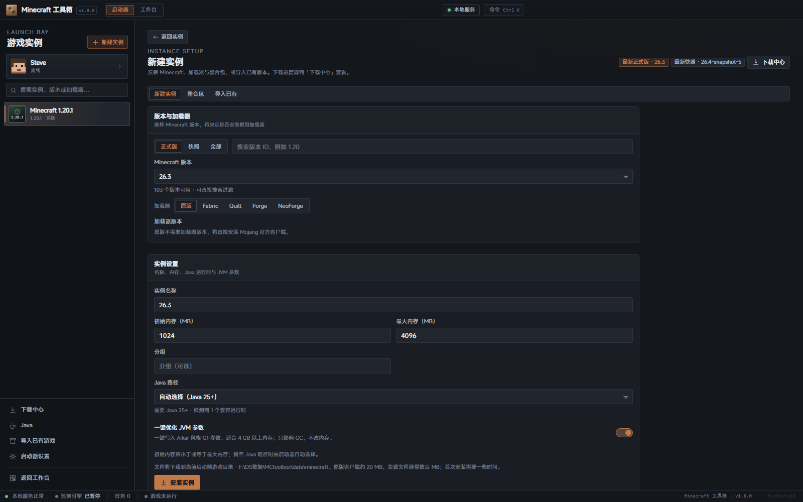
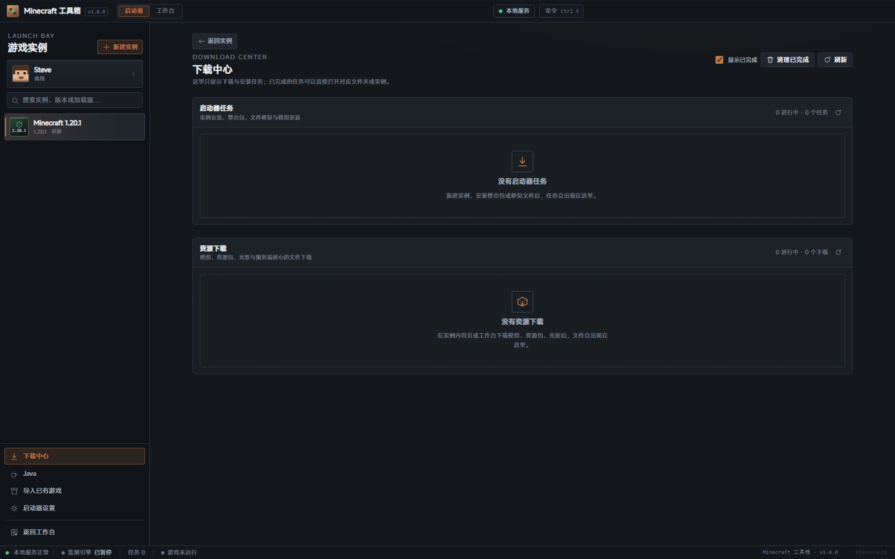
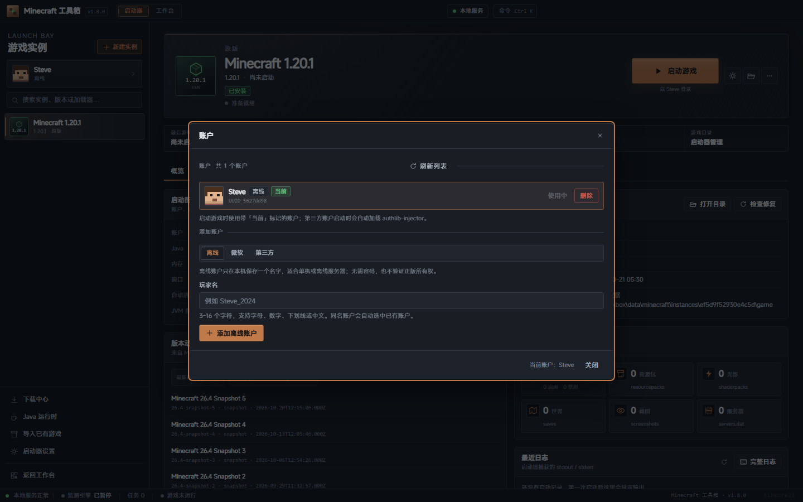
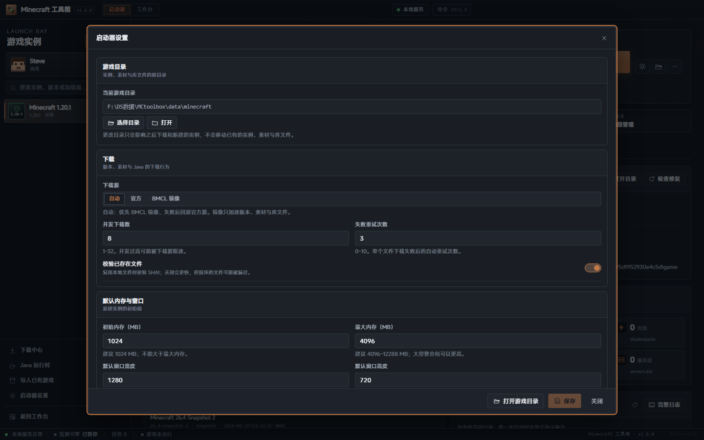
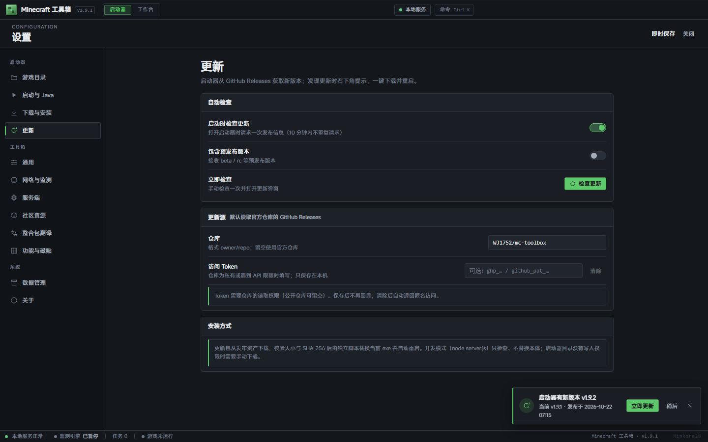

# Launch Bay · 内置启动器

v1.9.1 起启动器就是主页：应用启动后直接进入启动器，工作台只是标题栏里的另一个页面（侧栏「工作台」或 `Ctrl/Cmd+2`）。设置也合并成了同一页：启动器分组（游戏目录 / 启动与 Java / 下载与安装）与工具箱分组共用左侧导航和即时保存。首次进入启动器时会让你选择游戏目录，默认在启动器旁边创建 `.minecraft`（与 PCL / HMCL 一致），之后可随时在设置里更换。

v1.9.0 在 v1.8 启动器的基础上完成四项改造：PCL 风格 MC 版本筛选与真实版本识别、外部实例启动修复与阶段进度/结构化错误、新建实例的在线整合包搜索安装、已有实例导出为可重新安装的整合包。原有八个功能、数据目录与接口保持兼容。

## 1. 页面结构

```
标题栏  品牌 · 启动器/工作台 · 本地服务 · 命令
┌───────────────┬──────────────────────────────────────────────┐
│ 账户卡          │ 实例主面板                                      │
│ 搜索            │ 图标 / 名称 / 版本 / 账户 / 启动 · 停止           │
│ 实例列表        │ 启动进度条 · 阶段文案 · 取消 / 失败诊断           │
│                 │ 概览 / 模组 / 资源包 / 光影 / 世界 / 截图 / 服务器 / 日志 │
│ 下载/Java/导入  │ 概览：启动配置、实例信息、内容统计、最近日志、崩溃诊断 │
│ 工作台 / 设置   │                                                │
└───────────────┴──────────────────────────────────────────────┘
状态栏  本地服务 · 监测引擎 · 任务 · 游戏运行状态 · 版本 · 作者
```

- 实例列表按最近启动排序，可搜索名称、版本、加载器与分组；双击直接启动。侧栏标题会显示「N 运行中」，运行中的实例带绿色圆点。
- 概览顶部新增「正在运行 N 个实例」面板：启动器启动时会接管系统里已在运行的 Minecraft 进程，逐行提供切换、日志、停止；hero 同时保留「再开一个」，可在当前游戏不关闭的情况下启动其它实例。
- 「下载中心」独立成页，只展示启动器任务（安装/整合包/修复/模组更新/导出）与社区资源下载；已完成任务可打开对应文件夹或跳转实例页。
- 新建实例、整合包与「导入已有」在独立页面，从侧栏「新建实例」进入；整合包页提供「搜索下载」（默认）与「本地文件」两种模式。
- 实例设置弹窗覆盖名称、分组、内存、窗口、全屏、自动进服、Java、JVM/游戏参数与备注。
- 启动按钮旁常驻启动进度：准备阶段显示阶段序号、阶段名、真实/不确定进度与「取消」；失败后保留红色错误条，点击打开结构化诊断面板。hero 不随 tab 切换重建，因此切到日志页再回来进度不会丢失。
- 「更多操作 → 导出为整合包」和概览快捷操作均可打开导出弹窗，选择 `.mrpack` / 通用 `.zip`、是否包含存档/截图与输出目录。
- 命令面板新增「启动器」分组，可在任意页面启动/停止当前实例、打开账户、Java、设置与实例目录。
- 启动器是主页：品牌、侧栏「工作台」、标题栏与 `Ctrl/Cmd+1` 都可以在启动器与工作台之间切换；工作台左侧 Rail 顶部新增「启动器主页」按钮，不再用「返回工作台」暗示工作台才是首页。
- 首次进入启动器（或还没确认过游戏目录）时弹出「选择游戏目录」：默认使用 `<启动器目录>/.minecraft`，也可以选择其它文件夹；启动器会在其中创建标准的 versions / libraries / assets / instances。已有实例会记住各自的目录，更换目录不会移动或删除它们。
- 设置页左侧分为「启动器 / 工具箱 / 系统」三组：启动器设置（游戏目录与存储、启动与 Java、下载与安装）和工具箱设置共用一套即时保存；原来的「延迟监测」并入「网络与监测」，「客户端转服务端」与「服务端核心」并入「服务端」。

## 2. 功能范围（参考 HMCL / PCL2 / Prism 的常用能力）

| 能力 | 实现 |
| --- | --- |
| 原版安装 | Mojang 版本清单 + 客户端 JAR + libraries + assets（含旧版 virtual / map_to_resources） |
| 加载器 | Fabric、Quilt（profile JSON）；Forge、NeoForge（官方 installer `--installClient`，安装器依赖可走 BMCLAPI 镜像） |
| 下载源 | 自动（先测速再选 BMCLAPI / 官方，失败或 429 自动换源）、官方、BMCLAPI；并发 / 单文件分段线程 / 重试 / 校验可配置 |
| 进度与取消 | 真实字节数、实时速度与预计剩余时间、资源文件计数、Phase、日志；任务可取消并清理临时文件；启动准备独立进度状态，可取消 |
| 实例 | 创建/编辑/复制/删除/导入已有；内存、Java、窗口、全屏、服务器、JVM/游戏参数 |
| 运行实例接管 | 启动/轮询扫描 `java.exe` / `javaw.exe`，按 `--gameDir` 匹配已添加实例；启动器重启后仍显示运行中、PID、已运行时长；逐实例停止与 `latest.log` 增量日志 |
| 多开 | 不同实例可同时运行；「再开一个」保持当前进程并选择其它已安装实例启动；同一实例仍只允许一个进程 |
| 迁移 | 扫描标准 `.minecraft/versions`（官方 / PCL2 / HMCL），引用原目录不复制；真实 MC 版本按继承链/ JAR / 资源索引/版本目录推断，失败时要求手动指定 |
| 账户 | 离线（OfflinePlayer UUID）、微软设备代码 OAuth（内置公共客户端，也可填自己的 Azure ID）、authlib-injector 第三方 |
| 启动 | 版本继承、OS/arch 规则、Modern/legacy 参数、natives、日志配置、Forge ModLauncher；外部目录 libraries/assets/gameDir 按原 `.minecraft` 解析 |
| 启动反馈 | 账户 → 版本链 → Java → 文件 → natives → 进程 → 窗口 7 阶段；真实百分比或 indeterminate；结构化错误码与可操作按钮；异常退出崩溃诊断 |
| 日志 | stdout/stderr 实时捕获（log4j XML 转可读文本）、已保存日志、崩溃报告与中文诊断 |
| 模组 | JAR 拖入/选择、启停、删除、重复/缺失前置提示、Modrinth / CurseForge 搜索安装；按文件 SHA-1 检查 Modrinth 更新并解析缺失前置；按真实 modid + jar-in-jar 识别内嵌前置，不拿文件名猜 ID |
| 资源包 / 光影 | Modrinth / CurseForge 搜索、PCL 风格 MC 版本下拉、兼容版本优先与标记；ZIP 导入、启停（写 options.txt）、删除、打开目录 |
| 世界 / 截图 | 世界卡片（版本/模式/大小/时间）、截图缩略图与大图、删除/打开目录 |
| 服务器 | 读写 `servers.dat`、添加/删除、一键设为启动后自动连接 |
| 整合包 | Modrinth `.mrpack`、CurseForge ZIP、本工具导出的 `.mrpack`/`.zip`；在线搜索下载或本地文件；识别 MC/加载器、安装加载器、补文件、解压 overrides |
| 整合包导出 | `.mrpack`（`modrinth.index.json` + `overrides/`）与通用 `.zip`（`manifestType: mc-toolbox` + `overrides/`）；Modrinth 哈希匹配、配置/资源包/光影/options/servers，可选存档/截图；默认排除日志、崩溃、缓存、令牌 |
| 下载中心 | 实例安装/整合包/修复/模组更新/导出任务与社区资源下载统一展示，支持取消与清理记录 |
| 版本筛选 | 安装模组/资源包/光影弹窗使用可输入下拉：全部版本、当前实例真实版本（推荐）、Mojang 版本清单（新到旧）；非法值提示且不请求 |
| 版本列表 | 当前实例 MC + 加载器兼容项置顶、按发布时间倒序、适配/当前实例可用/推荐标记；不兼容折叠「其他版本（N）」 |
| JVM 优化 | 一键写入 Aikar 风格 G1 参数，只合并 GC 参数、不改动 `-Xms`/`-Xmx` |
| Java | 本机扫描（含官方启动器 runtime）、真实 `java -version` 校验、Temurin 下载、默认 Java |
| 启动器设置（整页设置） | 游戏目录与存储、下载源/并发/单文件线程/重试/校验、默认内存/窗口/参数、Java、微软 Client ID、启动行为 |
| 社区接口校验 | `gameVersion` 格式 + Mojang 清单校验；非法/未知版本回退全部版本并返回中文 `gameVersionNotice` |
| 启动器更新 | 启动时检查 GitHub Releases；发现新版本右下角提示，一键下载 exe、校验 SHA-256 后替换并自动重启；可忽略版本、可配 Token |
| 好友（中心服务器） | 用启动器已登录的正版微软账户登录自建好友服务器；按正版游戏 ID 添加，好友能看到真实 ID，自己可设昵称；离线/第三方账户拒绝 |
| 在线状态 | 服务器按心跳统计在线/离线与「正在玩的实例」，换设备登录后状态一致 |
| 好友聊天 | 消息存在服务器，支持离线消息、未读与已读；不再依赖双方同时在线 |
| 临时文件中转 | 整合包与模组文件上传到服务器，接收方下载后 10 分钟删除，未下载 24 小时过期；配额 5 GB/账号、15 GB 总量 |
| 模组对称补齐 | 双方清单上传到服务器对比；优先本地暂存/Modrinth，私有模组由对方经服务器临时中转 |
| 服务器安全 | 自签 HTTPS + 客户端证书指纹固定；公网 HTTP 拒绝；Minecraft 访问令牌只用于校验、不落盘 |

### 未实现 / 边界

- **OptiFine**：不做自动安装器（官方安装器依赖 GUI，且需要向游戏 JAR 注入补丁）。两条可用路径：在 Forge 实例中把 OptiFine JAR 放入 `mods/`；或先用原启动器安装，再用「导入已有」。不新增自动下载，避免分发第三方闭源文件。
- **微软登录**：默认使用内置公共客户端（PCL/HMCL 同款 Live Connect 设备码），无需注册 Azure 应用；也可在「设置 → 启动与 Java → Java 与账户」填写自己的 Azure 公共客户端 ID 覆盖。令牌刷新会自动沿用登录时的流程。
- **Prism 实例**：只支持标准 `.minecraft/versions` 布局。Prism 实例的 `mmc-pack.json` + `patches/*.json` 需要现场合成版本 JSON；若写入原 `.minecraft/versions` 会破坏「只引用不修改原目录」的约定，因此本轮不实现，继续建议先用 Prism 导出/复制为标准版本后导入。
- **皮肤**：只展示账户档案自带的皮肤（微软/第三方），不提供上传或本地皮肤仓库。
- **CurseForge**：使用官方 API Key（设置中已有）或 curse.tools 公共元数据；作者禁止自动下载时给出文件名与手动处理步骤，若本地已有 SHA-1 一致的文件会直接复用。在线整合包搜索/安装未配置 Key 时显示设置引导，不创建假任务。
- **资源包启停**：直接修改 `options.txt`；游戏运行中修改可能被游戏覆盖。
- **旧版 Forge 安装器**：通过官方 installer 运行；需要对应 Java（1.12.2 → Java 8）。安装器失败时会保留完整日志。
- **导出格式**：`.zip` 使用本工具的 `mc-toolbox` 清单（含 `files` 下载地址与哈希 + `overrides/`），可被本工具重新导入；`.mrpack` 按 Modrinth 规范生成，尽量兼容 PCL2 / Modrinth App。未匹配 Modrinth 的模组会放进 `overrides/mods/`，因此导出包仍可离线还原，但体积会相应增加。
- **好友账号**：只接受正版微软账户。服务器调用 Mojang 档案接口验证令牌，不保存访问令牌；离线账户、authlib 第三方账户无法通过校验。会话令牌 30 天，换设备需重新登录。
- **好友服务器**：需要自己有一台公网服务器（本文以 Ubuntu 24.04 为例）。服务器长期保存好友关系、聊天与模组清单；整合包/模组文件只做临时中转，下载后 10 分钟删除、未下载 24 小时过期，可用 `--quota-mb` / `--global-mb` 调整。
- **自签证书**：地址与 SHA-256 指纹内置在启动器里，玩家不需要也不能修改；换服务器/换证书必须改配置并重新发版。没有域名也能用。
- **聊天与隐私**：消息在服务器上以明文 JSONL 保存（磁盘权限受限），服务器管理员理论上可读；文件在删除前同样落在服务器磁盘。介意就不要用中心服务器模式。
- **好友文件**：单文件 ≤ 2 GB；不支持断点续传；同名文件会放到独立传输目录，不会覆盖本地已有文件。

## 3. 数据目录

启动器根目录默认是启动器旁边的 `.minecraft/`（dev 模式为项目根，发布版为 exe 同级；首次进入时会让你确认或改选）。旧版自动使用的 `<data>/minecraft/` 会继续作为「已有实例」的目录保留，不会丢实例：

```
<root>/
  versions/<versionId>/<versionId>.json|.jar
  libraries/…
  assets/indexes/*.json
  assets/objects/<xx>/<hash>
  assets/log_configs/client-*.xml
  assets/virtual/<indexId>/…            # 旧版资源
  cache/installers/…                    # Forge/NeoForge 安装器缓存
  cache/authlib-injector/…              # 第三方登录 agent
  cache/packs/<jobId>/                  # 整合包临时目录（在线任务成功/失败/取消都清理）
  cache/export/<jobId>/                 # 导出临时目录（成功/失败/取消都清理）
  exports/                              # 默认整合包导出目录
  versions/<实例名>/                     # 每个实例独占的游戏目录（实例名实时同步）
    mods/ saves/ options.txt …          # 版本隔离：模组、存档、设置都在这一层
    logs/launch-*.log                   # 启动器捕获日志
    natives/<jarVersion>/               # legacy natives 解压目录
    .mc-toolbox-instance.json           # 目录归属标记（区分实例目录与真版本目录）
  instances/<instanceId>/               # 旧布局，仅用于迁移期回退
    game/
```

> 实例目录名跟随实例名：重命名实例会同步改 `versions/<实例名>`（重名自动加 `-2`；目录被游戏占用时保留旧名，下次重命名再同步）。版本 JSON / libraries / assets 仍由所有实例共享，不会为每个实例复制一份游戏文件。


配置文件：

- `launcher.json`（配置目录）：启动器设置（含 `root` / `rootConfigured`）+ 实例清单 + 选中实例。每个实例会记录创建时的 `root`，切换游戏目录后仍能找到自己的文件。
- `launcherAccounts.json`（配置目录）：账户与令牌；Windows 下尝试 `chmod 600`。API 只返回脱敏字段，令牌不会进入前端或日志。
- 外部导入实例：`baseDir` 指向原 `.minecraft`，`gameDir` 可能是隔离版本目录；日志/natives 仍存放在启动器实例目录，启动时不会在外部目录创建 mods/saves 等启动器目录，删除实例不会删除原目录。
- 测试/便携场景可用环境变量 `MC_TOOLBOX_LAUNCHER_ROOT` 覆盖本次进程的启动器游戏根目录（不写入用户配置）。

## 4. 关键实现

### 4.1 版本继承、版本识别与规则

`src/server/launcher/launch-plan.js` 是纯函数层：

- `rulesAllow`：OS 名称、arch、version 正则、features；按顺序应用 allow/disallow。
- `combineVersions`：子版本覆盖标量；libraries 去重（子优先）；JVM/game 参数拼接；Forge 的空 `logging` 不会清除父版本日志配置。
- `libraryArtifacts`：优先 `downloads.artifact`，否则按 Maven 坐标构造 URL；legacy `natives` 分类器单独提取；现代 natives JAR 进 classpath。
- `buildLaunchPlan`：内存 → 用户 JVM → 版本 JVM；补 `-cp` 与 `-Djava.library.path`；日志配置；游戏参数、尺寸、服务器、自定义参数；离线/微软/第三方账户占位符。
- Forge 修复：将实际客户端 JAR 文件名追加到 `-DignoreList`，避免 ModLauncher 把 `1.20.1.jar` 当作自动模块导致 `module minecraft contains package ...`。
- `analyzeCrash`：OOM、Java 版本、NoSuchMethod/NoClassDef、 ModResolution、OpenGL、权限、网络等中文诊断。

`src/server/launcher/version-detect.js` 负责导入外部版本时识别真实 MC 版本：

1. 递归跟随 `inheritsFrom`，取继承链根版本 id；根 id 非法时继续看链上其他版本。
2. `json.jar`，其次 `json.clientVersion`。
3. `json.assetIndex.id`，其次 `json.assets`。
4. 版本目录中实际存在且带合法 id / 继承关系的原版版本 JSON。
5. 仅当值符合 Minecraft 版本格式（`1.20.1`、`26.3`、`1.20.1-pre1`、`24w14a` 等）时才采纳。
6. 仍无法判断时 `mc` 留空、`needsMc=true`，导入界面要求手动指定；`json.id` 只有通过格式校验时才可作为最后兜底，`M1182rebirth` 这类实例名/目录名永远不会被当作 MC 版本。

`inferRuntime` 同时返回 `mcSource`、`clientJarVersion`、`chain`，供导入界面显示来源（继承识别 / JAR 识别 / 版本目录）并写入实例 `mc`、`versionId`、`jarVersion`。

### 4.2 安装

`src/server/launcher/install.js`：

1. 取版本清单与版本 JSON，写 `versions/<mc>/<mc>.json`，下载客户端 JAR 与日志配置。
2. Fabric/Quilt：取 profile JSON，改写 `id` 为自定义版本 ID；Forge/NeoForge：下载官方 installer，写 `launcher_profiles.json`，**优先使用最接近要求的兼容 Java** 运行安装器（1.20.1 用 Java 17，不再挑 Java 25），读取 `version.json` 确定生成的版本 ID。
   - NeoForge 1.20.1 发布在 `net.neoforged:forge` 坐标（版本形如 `1.20.1-47.1.106`）；1.20.2+ 才使用 `net.neoforged:neoforge`；`forgeInstaller()` 会按 MC 版本选择正确坐标与 `expectedId`。
   - 非官方源时安装器本身从 BMCLAPI 下载，并预取 `version.json` / `install_profile.json` 中声明的库与 processor 的 `jar`/`classpath`；`mirrorUrl()` 同时把 `maven.neoforged.net` / `maven.minecraftforge.net` 映射到 BMCLAPI。`MOJMAPS` / `MERGED_MAPPINGS` / `MC_UNPACKED` 等 processor 生成物不再被误当成 Maven 包预取。
   - `DOWNLOAD_MOJMAPS` 会直连 Mojang，不受下载源设置影响。v1.9.4 起先用镜像链预取 `client_mappings`（校验 SHA-1/长度），再用 `jar-patch.js` 给安装器 profile 补 `--skipIfExists` 并生成 `*.patched.jar`，安装器日志会显示 `Skipping as output file exists`。
   - 新版 Forge 安装器（如 `1.20.1-47.4.0`）带 JAR 签名。修改 `install_profile.json` 后，Java 读取该条目会抛 `SecurityException: SHA-384 digest error`；`SimpleInstaller` 把异常吞掉，只打印「A problem installing was detected, install cannot continue」并以退出码 1 结束。v1.12.5 起 `patchJarEntry` 重写 JAR 时移除 `META-INF/*.SF|*.RSA|*.DSA|*.EC` 签名条目，写盘前自检补丁条目可读回且无残留签名（失败则不使用补丁 JAR）；任务日志会记录移除了哪些签名文件。
   - 安装器网络类失败（Connection reset / Connect timed out / HTTP 5xx）自动重试 3 次；最终错误会带上最后的异常行，而不是只有「退出码 1」。
3. `loadVersionChain` 合并继承链，按当前 OS 规则下载全部 libraries（含 natives）；asset index 与 objects 按 SHA-1 校验，支持镜像回退。
4. 写 `.mc-toolbox-installed` 标记并更新实例 `installedAt`；修复任务复用同一套文件检查/下载逻辑。
5. 任务由 `InstallJob` 管理：真实进度、日志环形缓冲、取消（AbortController + 杀安装器进程）、失败清理、完成后刷新实例。
6. 在线整合包 `startOnlinePackInstall`：先解析项目版本下载地址，下载到 `cache/packs/<jobId>/` 并按大小/SHA-1/SHA-512 校验，再复用同一套整合包安装管线；任务阶段固定为 下载整合包 → 校验整合包 → 解析清单 → 安装加载器 → 下载模组 → 解压覆盖文件 → 完成，成功/失败/取消都删除缓存目录。

### 4.3 启动阶段、进度与错误

`src/server/launcher/launch-phases.js`：

- 固定 7 个阶段：`account` 校验账户、`version` 解析版本与继承链、`java` 检查并选择 Java、`files` 校验客户端文件、`natives` 解压 natives、`spawn` 启动 Java 进程、`window` 等待游戏窗口出现。
- `window` 阶段是**真实检测**而不是计时：`src/server/launcher/game-window.js` 在 Windows 上轮询该 PID 的主窗口句柄（GLFW 窗口创建后非 0），其余情况回退到「窗口创建后才会打印」的日志标记（Render thread / LWJGL / OpenGL / Setting user）。只有命中其一，实例状态才从 `spawning` 变成 `running`；等待期间前端显示「正在等待游戏窗口出现…（已等待 Ns）」。
- `createLaunchError(code, …)` 为每种错误生成中文摘要、详细原因、可操作 actions 与相关路径。

`src/server/launcher/launch.js`：

- `startInstance` 立即返回 session snapshot（准备期间 `status='starting'`），真正准备在后台执行；`launchStatus().launch` 返回阶段、detail、progress、indeterminate、error、logFile 等字段。`GET /api/launcher/instances/:id/status` 每次轮询即可拿到最新阶段，切换页面不丢失。
- 账户/版本/Java/文件/spawn/window 阶段无法计算真实进度时 `progress=null` + `indeterminate=true`；natives 阶段使用 `extractZip` 的真实解压比例。不伪造百分比。
- 文件阶段检查客户端 JAR、classpath libraries、legacy natives JAR、asset index 与 objects（并发 stat，缺失计数，最多返回 20 项），并检查外部 `gameDir` 可写性。
- 取消：`cancelLaunch` 中止准备；已 spawn 时等同于停止游戏。用户主动停止标记 `stopping`，session 为 `stopped`、launch 为 `idle`，不误报崩溃。
- 异常退出：非用户停止且 code ≠ 0 时 session `failed`，launch `failed`，错误码为 `GAME_CRASHED`（有 crash-report）或 `GAME_EXITED`，附崩溃诊断、日志文件和 `open-logs` / `copy` 操作。
- 错误码：`NO_ACCOUNT`、`NO_JAVA`、`JAVA_TOO_OLD`、`VERSION_JSON_MISSING`、`MISSING_FILES`、`EXTERNAL_DIR_UNWRITABLE`、`ALREADY_RUNNING`、`SPAWN_FAILED`、`GAME_CRASHED`、`GAME_EXITED`。`src/server/api.js` 把 `code/detail/missing/missingCount/paths/actions/crash` 一并返回，前端 `core/api.js` 附加到 `Error` 上。
- 外部实例的 `versionsDir`/`librariesDir`/`assetsDir` 指向 `baseDir`，`nativesDir`/`logsDir` 仍在启动器实例目录；`ensureInstanceDirs` 不会在外部 gameDir 创建 mods/saves 等目录；客户端 JAR 按 `jarVersion` / `versionId` / `mc` 候选顺序取第一个真实存在的文件。
- 游戏进程用 `gameSpawnOptions()`（`detached: true`）启动：Windows 上 Node/libuv 会把非 detached 的子进程与启动器放进同一个 kill-on-close 作业对象，启动器退出（关窗、「启动后关闭启动器」、一键更新替换 exe 后重启）时作业句柄关闭，作业内的 MC 会被一起 `TerminateProcess` —— 表现是 `latest.log` 没有 `Stopping!`，直接停在上一条日志。detached 子进程不进入该作业，启动器退出后游戏继续运行；stdout/stderr 管道断开后 log4j2 的 Console appender 只写失败，游戏自己的文件日志与崩溃诊断不受影响（验证见 §6.11）。

#### 已运行进程接管与多开（v1.9.8）

`src/server/launcher/running-processes.js` + `launch.js`：

- 每次读取 `/api/launcher/bootstrap`、`/api/launcher/status`、`/api/launcher/running?force=1` 等状态前，先扫描系统进程：Windows 用 `Get-CimInstance Win32_Process`（失败回退 `Get-WmiObject`）读取 `java.exe` / `javaw.exe` 的 `CommandLine`，非 Windows 用 `ps -axo pid,ppid,etimes,command`。只保留同时带 `--gameDir` 与客户端特征（`--assetsDir` / `--assetIndex` / `-Dminecraft.*` / Mojang、Forge、Fabric、Quilt、NeoForge 主类）的进程。
- 用 `--gameDir` 做路径匹配（Windows 大小写/分隔符不敏感）到 `instancePaths(inst).gameDir`；只匹配已经添加进列表的实例，不会碰其它 Java 进程。检测结果缓存 4 秒（同一时刻的并发轮询复用一次 PowerShell）；扫描失败时保留上一次结果并标记 `stale`，避免把仍在运行的游戏误判成“已退出”而允许删除/覆盖实例。
- 启动器内存里的 session 优先；没有本地 session 或本地 session 已结束时，返回 `detected: true` / `external: true` 的接管 session，包含 `pid`、`startedAt`、`elapsed`、`logFile`。原始命令行（可能带 `--accessToken`）只在内存中用于匹配，`session.command` 置空，API 不返回。
- 停止：`POST /instances/:id/stop` 先强制刷新进程表并确认 PID + `gameDir`，Windows 先 `taskkill /PID <pid> /T`（请求正常关闭），8 秒后仍未退出再 `/F` 强制；Unix 先 `SIGTERM` 再 `SIGKILL`。同一实例仍只允许一个进程；不同实例的检测结果互不影响，`startInstance` 只拒绝当前实例的 `ALREADY_RUNNING`。
- 日志：外部进程没有 stdout 管道，`GET /instances/:id/log` 从 `<gameDir>/logs/latest.log` 尾部读 512 KiB，之后按文件字节偏移增量追加（保留最近 2000 行）；日志页每 3 秒刷新，检测到运行中时默认选中游戏 `latest.log`。
- 前端：侧栏运行数量与绿点；概览「正在运行 N 个实例」面板逐行提供切换 / 日志 / 停止；hero 显示「已接管外部进程 · PID」并提供「停止游戏」与「再开一个」；`再开一个` 弹窗只列未运行的已安装实例，保持当前进程不变。
- 边界：以更高权限运行、系统拒绝读取 `CommandLine` 的 Java 进程无法接管；同一个 `gameDir` 被多个实例引用时只显示最近游玩的一个（需要同版本多开请复制实例，不要共用目录）。检测失败时启动器会提示原因并保留上一次检测结果，不会把运行中的实例误判为已退出。

### 4.4 账户

`src/server/launcher/accounts.js`：

- 离线：`UUID.nameUUIDFromBytes("OfflinePlayer:"+name)` 兼容算法；随机 accessToken。
- 微软：设备码 → MS token → XBL → XSTS → Minecraft services → profile；保存 refresh token，启动前 5 分钟内自动刷新；XErr 映射为中文提示。未配置 Azure ID 时使用内置公共客户端 `00000000402b5328` 走 Live Connect 设备码；配置后走 Azure v2 设备码。`msFlow` 随账户保存，刷新时沿用同一端点。
- 第三方：authlib-injector / Yggdrasil `/authserver/authenticate`、`validate`、`refresh`；启动时下载并校验 SHA-256 的 agent，添加 `-javaagent`。
- 令牌存储本地；API 仅返回 id/type/name/uuid/皮肤/到期等。

### 4.5 整合包

`startPackInstall` / `startOnlinePackInstall`：

- 读取 `modrinth.index.json`、CurseForge `manifest.json`，或本工具导出的 `manifest.json`（`manifestType: mc-toolbox`），推断 MC、加载器与版本；`toolbox` 与 Modrinth 一样按 `files` 下载、复制 `overrides/`。
- ZIP 读取器按 EOCD 记录的偏移单独读取中央目录（必要时跟随 Zip64），不再只扫文件末尾 2 MiB；2 万+ 条目的 overrides 大包也能正确读到根目录清单。
- 安装基础版本/加载器后，解压 overrides/client-overrides 到实例游戏目录；Modrinth 按路径/哈希下载，CurseForge 按项目/文件 ID 补齐并校验 SHA-1。
- CurseForge 文件被作者禁止自动下载时（`allowModDistribution=false`），先查缓存、`mods/`、`resourcepacks/`、`shaderpacks/` 中是否有 SHA-1 一致的文件；命中则复用。
  - v1.12.6 起按缺失内容分别处理：只缺 `resourcepacks` / `shaderpacks` / `datapacks` 时跳过并继续安装（不影响启动），完成文案注明缺失数量，完整清单（文件名 + 项目网页地址）写入任务日志和实例目录 `.mc-toolbox-missing-files.txt`。
  - 缺失里含 `mods` 时仍然中止：错误信息列前 5 个 `项目/文件（文件名）` 并指向任务日志，同时设置 `keepOnFailure` 保留实例与已下载内容（不再整包删除）；用户补齐后重装会复用缓存与实例文件。完整清单（含项目网页地址）写入 `.mc-toolbox-missing-files.txt`。
- 记录 `.mc-toolbox-pack.json`；任务失败/取消时清理临时目录和上传文件（`keepOnFailure` 除外）。
- 在线任务下载地址从 Modrinth `/version` 或 CurseForge `/download-url` 解析；未配置 CurseForge API Key 时返回 `CURSEFORGE_API_KEY` 中文引导，前端显示「设置 → 社区资源」入口或改用 Modrinth。

### 4.6 导出整合包

`src/server/launcher/pack-export.js`：

- 模组：扫描 `mods/`，计算 SHA-1/SHA-512，POST Modrinth `/v2/version_files` 匹配版本；仅当版本的 `game_versions` 含实例 MC 且 `loaders` 含实例加载器、且文件哈希匹配时写入清单 `files`（下载地址、sha1/sha512、fileSize、env）；其余复制到 `overrides/mods/`。
- 配置：`config/`、`defaultconfigs/`、`kubejs/`、`resourcepacks/`、`shaderpacks/`、`options.txt`、`servers.dat`；可选 `saves/`、`screenshots/`（默认不包含）。
- 默认排除：日志、crash-reports、cache、backups、`.git`、`.mixin.out`、natives、`.mc-toolbox*`、`launcher_*.json`、`usercache.json`、`realms_persistence.json`、`servers.dat_old` 等账户/启动器内部文件。
- `.mrpack` 写 `modrinth.index.json`（`formatVersion:1`, `game:'minecraft'`, `dependencies`）与 `overrides/`；通用 `.zip` 写 `manifestType:'mc-toolbox'`、`minecraft`、`files` 与 `overrides/`，可被本工具重新导入。
- 输出默认 `<launcherRoot>/exports/`，文件名 `<名称>-<MC>-<加载器>-<时间戳>.<ext>`；staging 在 `cache/export/<jobId>`，成功/失败/取消都清理；先在输出目录写 `.part-*`，压缩包校验（清单存在、overrides 数量、files 路径）通过后才改名，避免半成品。
- 外部实例只读源目录；导出目录不能位于外部 baseDir 内。导出任务异步、可取消、带真实阶段进度与日志，前端弹窗与下载中心都能查看/打开所在文件夹。

### 4.7 内容安装版本筛选

`public/js/launcher/version-picker.js` + `public/js/launcher/content.js`：

- 可输入下拉：首项「全部版本」，次项「当前实例：<真实 MC 版本>（推荐）」，再列 Mojang 版本清单（新到旧），支持关键字过滤、键盘选择、手动输入合法版本回车应用；非法值显示提示且不发送请求。
- 搜索结果顶部显示「筛选：1.20.1 · Fabric」；服务端返回 `gameVersionNotice` 时显示金色警告。
- 项目版本列表读取全部版本，前端按实例 MC + 加载器分组：兼容项按发布时间倒序、行内标记「适配 1.20.1」「当前实例可用」「推荐」，加载器用强调色；不兼容项折叠到「其他版本（N）」，支持「显示全部版本 / 只看适配版本」；无兼容项时显示「该内容没有适配 X 的版本」+「查看全部版本」。
- 安装写入的 `meta.gameversion` 始终是实例真实 `mc`，不再使用实例名或版本文件夹名。

### 4.8 启动器自身更新

`src/server/launcher/app-update.js` + `public/js/launcher/update.js`：

- 版本源是 GitHub Releases：读取 `/repos/:owner/:repo/releases`，按语义化版本取最高项，默认忽略草稿与预发布（可在设置里接受预发布）；当前版本来自构建注入的 `PRODUCT_VERSION`。
- 检查结果缓存 10 分钟，`force=1` 绕过缓存。找不到仓库/发布、Token 失效、API 限额、网络错误都返回中文可操作提示；私有仓库或限额问题在「设置 → 启动器 → 更新」填 Token（只保存在本机，接口不回显）。
- 资产优先选 `mc-toolbox.exe`，其次其它 `.exe`；下载复用 `download.js` 的 `fetchToFile`（代理、重试、30 秒无数据中止），下载后按 `size` 与 GitHub 返回的 `sha256` digest 校验。
- 一键更新只允许 Windows 打包版（SEA）：服务端先把替换脚本写到临时目录并以独立进程启动；脚本等待旧进程退出（最长 180 秒）→ 目标 exe 改名 `.old` 备份 → 复制新 exe → 校验 → 删除备份 → 启动新版；任一步失败会回滚备份并拉回旧版。开发模式（`node server.js`）拒绝替换，只提示手动下载。
- 更新只结束启动器自身：游戏进程以 `detached: true` 启动、不在启动器的作业对象里（§4.3），所以替换脚本等待旧进程退出、重启新版时，正在运行的游戏不会被连带关闭。
- 前端在启动器加载后按设置自动检查一次；发现新版本时右下角显示常驻卡片（立即更新 / 稍后），弹窗展示版本号、发布时间、发布说明与下载进度；替换成功后通过 WebView2 `close` 消息（或 shutdown beacon）关闭窗口，由脚本重启。命令面板「检查启动器更新」、设置 → 关于、设置 → 启动器 → 更新都可手动触发。
- 更新弹窗是单例：`openUpdateDialog` 用模块级 `activeDialog` 记住当前弹窗，重复调用（卡片「立即更新」、设置页「检查更新」、命令面板）只通过 `raiseModal` 把已有弹窗提到最上层，不再叠第二份。弹窗打开期间右下角卡片会收起（`renderCard` 在 `activeDialog` 存在时直接返回），关闭时再恢复，避免 `toastRoot`（z-index 400）里的卡片压住弹窗（z-index 200）底部按钮、被误当成弹窗自己的按钮。

### 4.9 模组真实 modid 与内嵌依赖（v1.9.8）

`src/server/mods.js` + `src/server/launcher/content.js`：

- 元数据按实例加载器选择：Forge/Cleanroom 优先 `META-INF/mods.toml`，NeoForge 优先 `META-INF/neoforge.mods.toml`，Fabric/Quilt 优先 `fabric.mod.json` / `quilt.mod.json`。同一个 jar 同时带多套元数据时（CreativeCore、ItemPhysic 等）不会再拿 Fabric 的 `depends` 给 Forge 实例报 `fabric-api` 缺失。
- `[[dependencies.<owner>]]` 只接受 owner 出现在本 jar `[[mods]]` 里的块；`[[dependencies.xaerobetterpvp]]` 这类没有对应 `[[mods]]` 的残留块不会算到宿主头上。`optional` / `incompatible` / `side=CLIENT` 的规则保持原判断。
- 内嵌依赖：读取 Forge/NeoForge `META-INF/jarjar/metadata.json` 的 `jars[].path`、Fabric/Quilt `jars`、旧 Forge `ContainedDeps`，并兜底扫描 `META-INF/jarjar/*.jar` / `META-INF/jars/*.jar`。每个子 jar 递归读取元数据；`nestedModIds` 记录全部内嵌 ID（含客户端子模块），`modids` 只记录服务端转换可见的 ID，避免把客户端子模块并进宿主导致整包被误删。
- fat jar 没有主元数据时（如 `kotlinforforge-4.12.0-all.jar`）用第一个带 `modid` 的 jar-in-jar 子模块回填宿主；真实元数据存在时 `modids` 不再混入从文件名推断的 ID（`xaerominimap-forge-1.20.1-26.4.2` 只是 `modIdHints`，仅无元数据时兜底）。
- `scanModsDir` 返回 `providedModIds`（真实 ID + 内嵌 ID）与 `modIdHints`；`listMods` 用 `providedModIds` 判断依赖是否满足，并把 ID 归一化为小写字母数字（`yumi-commons-core` 与 `yumi_commons_core` 视为同一个）。
- 加载器不匹配：Forge 实例里的纯 Fabric jar（如 LambDynamicLights、fabric-language-kotlin）标记 `loaderMismatch`，UI 显示「加载器不匹配」并忽略其依赖缺失；旧 Forge 的 `FMLCorePlugin` / `TweakClass` / `FMLModType` / ModLauncher Service 通过 `loaderHints` 视为兼容，不误判。

### 4.10 好友：正版账号登录、中心服务器与临时文件中转（v1.11.0）

好友系统不再做 P2P：客户端用启动器里已登录的正版微软账户换取服务器会话，好友关系、在线状态、聊天与文件都经过服务器。

**1）身份与登录**（`src/server/friends/server-client.js`、`tools/friends-server.mjs`）

- 客户端从启动器账户模块取出可用的 Minecraft 访问令牌（`getAccountForLaunch`，过期会自动刷新），POST 到 `/api/auth/minecraft`。
- 服务器调用 `https://api.minecraftservices.com/minecraft/profile` 校验令牌，拿到 UUID 与正版 ID；令牌只用于这一次校验，不写盘。服务器发 30 天随机会话令牌，本地按 `sha256` 存哈希。
- 注册可加邀请码（`--invite` / `MCTB_FRIENDS_INVITE`）；已有账户再次登录不再要求邀请码。离线与 authlib 账户在客户端就被拒绝。
- 本地 `friends.json`（0600）保存内置服务器地址、证书指纹、会话令牌与偏好；不保存 MC 访问令牌。

**2）传输安全与服务器地址**

- 服务器地址与证书 SHA-256 指纹写死在 `src/server/friends/config.js`，好友页只显示「官方服务器（内置）」，不显示地址/指纹，也没有修改入口；旧配置里的自定义地址会被覆盖。
- 客户端每次响应都比对内置指纹，不一致立即断开（`TLS_FINGERPRINT_MISMATCH`）。公网 `http://` 直接拒绝；开发测试可用 `MC_TOOLBOX_FRIENDS_SERVER` / `MC_TOOLBOX_FRIENDS_FINGERPRINT` 环境变量指向本地服务器。
- 换服务器或换证书必须改内置配置并重新发版，不再由玩家手工确认。

**3）服务器数据与接口**

- 数据目录：`accounts.json`（账户、好友、请求、readAt、活动）、`sessions.json`（令牌哈希）、`messages/<a>_<b>.jsonl`（按好友对存聊天）、`mods/<uuid>.json`（各实例模组清单）、`files/index.json` + `files/<id>.bin`（临时文件）。
- 在线状态由请求时间 + 心跳计算（70 秒窗口）；活动信息由启动器每 25 秒心跳上报，可在设置里关闭。
- 文件：`POST /api/files` 创建 → `PUT /api/files/:id` 原始字节（校验 Content-Length/SHA-1）→ 接收方 `GET /api/files/:id/download`；下载完成 10 分钟后删除，未下载 24 小时过期。配额默认 5 GB/账号、15 GB 全局。
- 聊天：`GET/POST /api/messages`，按好友对存储；`POST /api/read` 记录已读位置；离线消息随下次拉取返回。
- 模组：`PUT /api/mods/:key` 上传清单，`GET /api/mods?uuid=` 仅好友可读；对比在客户端完成，补齐复用 `mods-sync.js` 的差异/停用/校验逻辑。

**4）客户端行为**

- `src/server/friends/manager.js` 负责：探测/保存服务器、登录、心跳、好友与聊天拉取、导出并上传整合包、下载并校验文件、模组清单上传/对比/补齐/直传。
- 文件下载落到 `DATA_DIR/friends/received/<文件 id>/`，按服务器返回的 SHA-1 校验；整合包出现在「收到的整合包」，可直接安装。
- 聊天页每 2 秒轮询好友/文件，1.2 秒轮询当前会话；没有 WebSocket 依赖。

### 4.11 下载引擎：测速选源、分段并发与实时速度（v1.12.3）

**1）为什么之前慢**

- `auto` 源过去写死「BMCLAPI 优先」：BMCLAPI 现在按连接限速，并会用 302 把请求转到带签名的 CDN；2026-10 实测同一条线路，BMCLAPI 单连接只有约 0.2 MB/s，而官方 CDN 单连接可以到 10 MB/s。所有文件都先撞一遍慢线路，整体自然停在几百 KB/s。
- 单文件只有一个连接；素材阶段并发固定为 8，几千个小文件排队；大文件（客户端 JAR、整合包、几十 MB 音频）没有任何并行。
- 安装任务的 `InstallJob` 没有 `speed` 字段，界面只能显示字节数与百分比。

**2）实现**（`src/server/launcher/download.js`、`source-select.js`、`speed-meter.js`）

- **测速选源**：`自动` 模式下先用 `Range: bytes=0-N` 对每条候选线路做一次 256 KB 轻量测速（同一 host 10 分钟内只测一次，探测并发去重），按实测吞吐排序；素材阶段还会拿最大的一个音频再测一次，日志写明「线路测速：…」。`官方` / `BMCL 镜像` 两种显式选择保持用户给的顺序。
- **失败与限流**：429 说明并发太高，先按单连接重试一次；仍 429 则把该线路封 30 秒并排到最后，交给另一个源。404/403 不重试。连接失败 10 分钟内降级，成功样本会清掉失败标记。
- **分段下载**：≥4 MB 的文件用 `Range` 切成 1–8 MB 的块，默认 4 条连接动态领取（慢连接不会拖住尾巴）；每个文件先 `bytes=0-0` 探测总长度与 Range 支持，服务器忽略 Range 时自动退回单连接。SHA-1 在写盘后统一校验，分段与顺序无关。
- **并发**：素材 16–64（默认 8 → 32），依赖库 8–32；单文件线程 1–16 可配。
- **实时速度**：`InstallJob` 每 500 ms 采样 `received` 并做指数平滑（无新字节时 2 秒内衰减到 0），`public()` 暴露 `speed`；前端 `core/jobs.js` 统一渲染「字节 / 百分比 / 速度 / 剩余时间 / 已进行」。
- **设置**：`设置 → 启动器 → 下载与安装` 新增「单文件分段线程数」，并更新下载源与并发说明。

## 5. 接口

完整列表见 README「常用 API」。核心前缀 `/api/launcher`：

- `bootstrap` / `settings` / `status` / `sessions` / `running`（当前运行实例，`?force=1` 强制扫描）
- `instances` CRUD、`select`、`repair`、`launch`、`launch/cancel`、`stop`、`preview`、`status`（含 `launch` 阶段与 `detected` / `external`）、`log`、`crash`
- `instances/:id/content?type=mods|resourcepacks|shaderpacks|worlds|screenshots|servers|logs|summary`
- `instances/:id/upload`（原始字节 + `X-File-Name`）、`mods/toggle`、`mods/delete`、`content/delete`、`resourcepack`、`servers`
- `instances/:id/mods/updates`、`mods/update`、`mods/missing`（Modrinth 更新检查 / 缺失前置）
- `instances/:id/mods/duplicates`、`mods/dedupe`（重复模组报告；按组提交 `keep` / `remove` 与 `mode=delete|disable`）
- `instances/:id/export`（创建导出任务）、`exports`、`exports/:id`、`exports/:id/cancel`
- `versions`、`loaders/:loader/versions`、`install`、`jobs`、`packs/install|upload|inspect|install-online`
- `java`、`java/required`、`accounts/*`（离线/微软/authlib/select/refresh/delete）
- `import/scan`、`import`（可传 `mc` 手动指定）、`news`
- `update/check`、`update/state`、`update/download`、`update/apply`、`update/skip`、`update/reset`、`update/config`（检查 / 下载进度 / 替换重启 / 忽略版本 / 更新源配置）

好友接口 `/api/friends`（中心服务器模式）：

- `GET /api/friends`（配置/登录/好友/请求/传输/收到的包/任务/事件）、`GET /api/friends/diagnostics`
- `POST /api/friends/login`（邀请码可选）、`POST /api/friends/logout`、`POST /api/friends/session/refresh`
- `PUT /api/friends/self`（昵称 / 活动开关）
- `POST /api/friends/add`（正版 ID）、`POST /api/friends/respond`、`DELETE /api/friends/:uuid`
- `GET|POST /api/friends/:uuid/messages`、`POST /api/friends/:uuid/read`
- `POST /api/friends/packs/share`、`POST /api/friends/transfers/:id/download`、`DELETE /api/friends/transfers/:id`
- `POST /api/friends/received/clear`（清空全部接收记录）、`POST /api/friends/received/:id/save-as`、`POST /api/friends/received/:id/apply`、`DELETE /api/friends/received/:id`
- `POST /api/friends/mods/compare|fill|send`、`GET /api/friends/mods/jobs/:id`、`POST /api/friends/mods/jobs/:id/cancel`

## 6. 验证记录

验证环境：Windows 10 x64、Node 22.18、Edge 155（CDP headless）、Java 25.0.1（官方启动器 runtime `java-runtime-epsilon`）；日期 2026-10-21。

### 6.1 自动化测试

- `node --test tests/*.test.mjs`：**105 项全部通过**。
- 新增/相关测试：
  - `tests/launcher-import.test.mjs`：版本格式、继承链、jar/clientVersion、assetIndex/assets、版本目录兜底、识别失败必须手动指定、隔离目录、`MC_VERSION_REQUIRED`/`INVALID_MC_VERSION`、清单缓存/BMCLAPI 回退、`validateGameVersion`。
  - `tests/launcher-launch-state.test.mjs`：阶段顺序与中文标签、10 个错误码、`publicLaunchState` 字段隔离、外部实例路径与 `ensureInstanceDirs` 不写外部 gameDir、Java 缺失/过旧分类、`VERSION_JSON_MISSING`。
  - `tests/launcher-pack-online.test.mjs`：Modrinth 版本解析、CurseForge 无 Key 引导、download-url 解析、`mc-toolbox` 清单识别、下载失败后的缓存清理。
  - `tests/launcher-pack-export.test.mjs`：`.mrpack` / 通用 `.zip` 结构、Modrinth 匹配与 overrides、默认排除存档/日志/令牌、勾选包含、外部目录只读、失败/取消清理、导出后 `readPackSummary` 识别。
  - `tests/launcher-version-picker.test.mjs`：版本格式、兼容判断、兼容/其他分组与推荐、筛选文案、徽章。
  - `tests/launcher-launch-panel.test.mjs` / `tests/launcher-install-ui.test.mjs`：前端启动阶段文案/进度/错误兼容、导入手动 MC 校验、在线整合包状态机、下载中心导出任务合并。
  - `tests/zip-reader.test.mjs`：中央目录超过 2 MiB（24000+ 条 overrides）时仍能读取根目录 `modrinth.index.json`，普通小包/通配符/stats 行为不变。
- 测试不再修改真实 `data/launcher.json`（使用 `MC_TOOLBOX_LAUNCHER_ROOT` 临时根与注入 create/fetcher），全量运行前后状态文件 SHA-1 一致；取消下载测试等待 PID 文本完整写入并轮询子进程退出，避免高负载下的偶发失败。连续 3 次全量运行均为 105/105。

### 6.2 构建与 EXE

- `node build.mjs` 成功：`dist/mc-toolbox.exe` **82.7 MB**；esbuild bundle 700.1 KB；public.tar.gz 259.7 KB；mc-i18n 运行时 353.0 KB；SEA blob 1580.2 KB；host.exe + WebView2 DLL 267.3 KB；应用图标 7 种尺寸校验通过。
- 构建脚本隔离冒烟：EXE 启动、首页、功能列表、作者信息与完整性校验全部通过。
- `src/server/integrity.gen.js` 与 `src/server/asset-version.gen.js` 由构建自动更新；新增 `css/launcher-versions.css`、`css/launcher-launch.css` 与 `js/launcher/version-picker.js` 已包含进壳文件清单。

### 6.3 外部 PCL2 实例（真实环境）

- 扫描 `C:\Users\HP\AppData\Roaming\.minecraft`（PCL2）：版本 `26.2`，`mc=26.2`、`mcSource=versionDir`、`clientJarVersion=26.2`、`isolated=true`，`gameDir` 为 `versions/26.2`；**没有**出现把实例名/版本文件夹名当 MC 版本的情况。
- 导入后实例 mc=`26.2`、versionId=`26.2`、jarVersion=`26.2`、external=true；`paths.versionJson/clientJarCandidates/librariesDir/assetsDir` 均指向外部 `.minecraft`，`nativesDir/logsDir` 在启动器实例目录。
- 启动到主菜单：阶段日志为 校验账户 → 解析版本 → 检查 Java（Java 25.0.1）→ 校验客户端文件（89 个库）→ 解压 natives → 启动 Java 进程 → 窗口就绪；游戏日志出现 NVIDIA 渲染设备、OpenAL、纹理图集，状态 `running`，`tasklist` 有对应 java 进程。用户停止后 session `stopped`、launch `idle`、无崩溃误报。
- 外部 26.2 实例搜索光影（`gameVersion=26.2`）返回 492 个结果；Sodium + Fabric + 26.2 返回 43 个结果。`M1182rebirth` 作为版本输入时返回「不是有效的 MC 版本号，已按全部版本搜索」。
- 导入界面手动 MC 验证：`M1182rebirth` 版本 JSON 无继承信息时显示「需要手动选择 MC 版本」与输入框，填 `1.21.8` 后成功创建实例，`versionId=M1182rebirth`、`mc=1.21.8`、`mcSource=manual`。

### 6.4 启动阶段与错误（真实环境）

- 启动 26.2 外部实例时轮询到 `preparing` → `spawning` → `window` → `running`，每阶段返回 `phase/detail/step/total/progress/indeterminate`；natives 使用真实解压比例，其余阶段无真实比例时 `progress=null`。
- `ALREADY_RUNNING`：重复启动返回中文提示、`code=ALREADY_RUNNING`、`actions=['open-logs']` 与路径。
- 取消准备：启动 Fabric 实例后 120ms 取消，launch `cancelled`、session `stopped`、无 Java 进程残留。
- `VERSION_JSON_MISSING`：删除临时外部版本 JSON 后启动，错误码与中文说明正确，`actions=['repair','open-game-dir','copy']`，路径包含版本 JSON。
- `MISSING_FILES`：临时版本缺少客户端 JAR 与资源索引，返回 `缺失 2 个文件`、缺失清单与 `repair/open-game-dir/open-logs/copy`。
- `JAVA_TOO_OLD`：版本声明 `javaVersion.majorVersion=99`，返回「未找到兼容的 Java 99」与 `select-java`。
- `GAME_EXITED`：构造 mainClass 不存在的版本，Java 进程启动后快速退出，launch `failed`，错误含退出码、日志入口与 `open-logs/copy`。
- 前端错误面板显示摘要、错误码、详细原因、缺失文件列表、相关路径与「检查并修复文件 / 选择 Java / 打开游戏目录 / 打开日志 / 复制错误信息」；非用户停止的异常退出在概览保留持久诊断卡，不只弹 toast。

### 6.5 在线整合包（真实环境）

- Modrinth 搜索 `fps`（type=modpack, 1.20.1）返回 281 个结果；在线安装「FPS Modpack 1.8」（`nJ2Rn3SV` / `fhqny3KP`，6.7 KB `.mrpack`）。
- 任务阶段：下载整合包（真实字节 0–28%）→ 校验 → 解析清单 → 安装加载器（1.20.1 + Fabric 0.15.10，资源文件 3598 个 / 622 MB）→ 下载模组 → 解压覆盖文件 → 完成；新实例 `installed=true`，12 个模组全部启用，`.mc-toolbox-pack.json` 记录正确。
- CurseForge 未配置 API Key 时在线安装返回 `CURSEFORGE_API_KEY` 中文引导（设置 → 社区资源），不创建任务。
- 下载缓存 `data/minecraft/cache/packs` 在成功后为空，无残留。

### 6.6 导出 / 重新导入（真实环境）

- 对在线安装的 1.20.1 Fabric 实例导出：
  - `.mrpack`：6.2 KB，含 `modrinth.index.json`（12 个 Modrinth 文件，sha1+sha512、downloads、fileSize）与 13 个 `overrides/` 文件（config、options.txt）；`dependencies` 为 `minecraft=1.20.1`、`fabric-loader=0.15.10`。
  - 通用 `.zip`：6.3 KB，含 `manifestType: mc-toolbox`、`files`、`overrides/`，`minecraft.version=1.20.1`、`modLoaders=[fabric-0.15.10]`。
- 默认不包含 `saves/`、`screenshots/`、`logs/`、崩溃报告、账户令牌；勾选后才复制存档/截图。
- 用本工具「整合包 → 本地文件」重新导入 `.zip`：识别为 `toolbox`，创建实例，12 个模组与 10 个 config 文件就位；启动到 Fabric 模组加载阶段（c2me / sodium 等 mixin 初始化），可正常进入游戏。
- 用本工具导出的 `.mrpack` 重新导入原始 1.20.1 实例的整合包：识别为 Modrinth 格式，创建 `MRPACK 重导入验收` 实例并完成安装，`options.txt` 等 overrides 就位。
- 通过 UI「更多操作 → 导出为整合包」对 26.2 外部实例执行一次导出：弹窗显示任务阶段、完成文件与「打开所在文件夹」，下载中心同步显示导出任务；默认输出到 `data/minecraft/exports/`。
- 外部 26.2 实例导出 `.zip`：只复制 `options.txt`/`servers.dat`，源目录文件集合与导出前一致（导出只读）；导出目录拒绝放在外部 `.minecraft` 内。
- 导出任务在下载中心显示「导出整合包」「打开所在文件夹」，完成状态含格式/大小。

### 6.7 UI 回归

- `tools/launcher-ui-smoke.mjs`：**20/20 通过**（新增 1280×820 无横向溢出、v1.9 样式表加载、900px 窄窗、亮色主题、控制台异常检查），截图输出 `dist/_ui-smoke-v19b`。
- 额外新功能 UI 验收：**21/21 通过**，覆盖：
  - 安装弹窗版本下拉（全部版本 / 当前实例 1.20.1 推荐 / Mojang 版本列表）、筛选条件「筛选：1.20.1 · Fabric」、非法 `M1182rebirth` 提示；
  - Sodium 版本列表：13 个兼容项置顶并标记「当前实例可用/推荐/Fabric」，245 个其他版本折叠并可展开；
  - 在线整合包搜索/版本列表/「下载并安装」；
  - 导出弹窗（格式、包含存档/截图、导出目录、说明），并从弹窗实际启动一次导出，完成状态显示文件/大小与「打开所在文件夹」；
  - 文件缺失实例的失败错误条与结构化面板（摘要/缺失文件/路径/4 个操作按钮）；
  - 900px 窄窗无横向溢出、无控制台异常。
- 回归：模组启停/删除/更新、资源包/光影安装、下载中心、实例设置、命令面板、工作台切换均保持可用。

### 6.8 未做真实验收 / 已知边界

- OptiFine：结论是不补自动安装器（需要 GUI/补丁注入，且涉及闭源分发）；保留 Forge `mods/` 与「导入已有」两条路径，已写入边界说明。
- Prism `mmc-pack.json`：结论是本轮不补。现场合成版本 JSON 需要写入原 `.minecraft/versions`，与「引用原目录、不改原目录」冲突；继续建议先导出为标准版本后导入。
- CurseForge 在线安装需要用户自己的 API Key；没有 Key 时只验证了引导文案与拒绝创建任务，未做真实 CF 在线整合包下载。
- 外部实例的真实启动验收使用本机 PCL2/官方 `.minecraft` 的 26.2；其它 PCL2 版本隔离布局（仅 `saves/`、自定义 JAR 命名）由单元测试覆盖，未逐一真机启动。

### 6.9 启动器自我更新（真实环境）

验证环境：Windows 10 x64、Edge（headless CDP 驱动界面）、打包版 `mc-toolbox.exe`（SEA）、GitHub Releases 公有仓库；日期 2026-10-22。

- 版本比较：`tests/launcher-update.test.mjs` 覆盖 `v1.9.2` / 预发布标签解析、数值比较（1.9.2 < 1.9.10）、草稿/预发布过滤、资产优先级（`mc-toolbox.exe` 优先）、替换脚本的路径转义、参数保留与回滚分支。
- 检查与下载：1.9.2 打包版匿名访问 `releases/latest` 发现 1.9.3；下载 86.7 MB 资产后按 `size` + GitHub `sha256` digest 校验通过（`/api/launcher/update/state` 从 downloading → ready）。
- 一键更新：界面点「立即更新 → 下载并更新」，弹窗显示下载进度并走到「更新完成，启动器正在重启…」；独立脚本日志依次出现 `update start → replace ok → relaunched`，目标 exe 的 SHA-256 变为 1.9.3，重启后的实例 `/api/bootstrap` 返回 `version: 1.9.3`，再次检查更新返回 `updateAvailable: false`。
- 关键回归：Windows 作业对象会在父进程退出时连带结束普通子进程（实测 `taskkill` 后替换脚本消失），因此替换脚本改用 WMI（`Invoke-CimMethod Win32_Process Create`）在作业外启动；`detached: true` 会让 PowerShell 5.1 静默退出，已避免；重启时空参数不能传给 `Start-Process -ArgumentList`，已按 `$argList.Count` 分支处理。游戏进程同样受这个作业对象影响，见 §6.11。
- 开发模式（`node server.js`）只检查/下载，`update/apply` 返回可操作提示，不替换进程。
- 更新源（`owner/repo`、Token、是否接受预发布、忽略版本）可在「设置 → 启动器 → 更新」修改；Token 不随接口回显。

### 6.10 Forge 安装失败与拖拽遮罩（v1.9.4，真实环境）

验证环境：Windows 10 x64、Node 22.18、Java 17.0.2 / Java 21.0.5 / 官方启动器 Java 25.0.1、真实 Forge 1.20.1-47.4.22 安装器；日期 2026-10-22。

- 现场失败：安装器在 `DOWNLOAD_MOJMAPS` 阶段访问 `launchermeta.mojang.com` 时 `java.net.SocketException: Connection reset`，退出码 1；同时日志首行显示安装器被 Java 25 启动（`JVM info: Microsoft - 25.0.1`）。
- 修复后真实安装：自动选择 Java 17；预取 `client_mappings`（8,001,795 字节 / SHA-1 校验通过），安装器日志出现 `--skipIfExists` 与 `Skipping as output file exists`；安装器成功输出 `Successfully installed client into launcher.`，实例 `1.20.1-forge-47.4.22` 标记为已安装。
- 网络重试：安装器输出中的 `SocketException` / `Connect timed out` / `Connection reset` / HTTP 5xx 会触发最多 3 次自动重试；非网络错误（如 Java class 版本）不会重试。
- 拖拽遮罩：headless CDP 模拟 `dragenter`/`dragover` 后遮罩出现；`dragend` 后 60ms 内清除；停止 `dragover` 1.5 秒后看门狗自动清除，不再卡死页面。
- UI 回归：`node tools/launcher-ui-smoke.mjs` 27/27（新增拖放遮罩、下载中心安装入口、吸顶进度坞检查）。

### 6.11 更新启动器不再关闭正在运行的游戏

验证环境：Windows 10 x64、Node 22.18、Java 21.0.5、log4j2 2.19（MC 1.20.1 同版本）、真实 Forge 1.20.1 实例日志；日期 2026-10-23。

- 现场：`versions/BattleArmory TACZ/logs/latest.log` 停在 `[03:22:30] [Render thread/WARN]: Game took 34.744 seconds to start`，**没有 `Stopping!`**；`%TEMP%\mc-toolbox-update\1.9.5\apply-update.log` 显示 `03:23:31 update start → 03:23:35 replace ok → 03:23:36 relaunched`，即替换脚本等待旧启动器退出的那一刻，正在玩的 MC 被一起结束。
- 根因：Windows 上 Node/libuv 第一次 spawn 非 detached 子进程后，会把父进程和子进程一起放进 kill-on-close 作业对象。探针（WMI 启动、不在其它作业里的 node 父进程）：spawn 前 `IsProcessInJob=false`，spawn 后立刻变成 `true`；父进程 `process.exit(0)` 后普通子进程 4 秒内在进程表里消失（`stdio: 'ignore'` 同样）。游戏正是这种普通子进程，所以「启动器退出 → 作业关闭 → java 被 `TerminateProcess`」。
- 修复：`spawnGame` 改用 `gameSpawnOptions()`（`detached: true`，日志仍走 stdout/stderr 管道）。探针：伪启动器先 spawn 一个普通 helper（作业已成立），再以 detached 拉起 java，`IsProcessInJob(java)=false`；父进程退出 4 秒后 java 仍存活（`gameAlive=True`），而 helper 随作业结束。
- 管道断开不影响游戏：用 log4j2 2.19 + Console(`SYSTEM_OUT`) + File appender 复现 MC 的日志配置，detached 拉起后结束父进程，JVM 仍存活，文件 appender 的 `log4jtest.log` 在父进程退出后继续从 16,533 字节增长到 23,057 字节。也就是说控制台回显会断，游戏本身和 `latest.log` 不受影响。
- 回归：`tests/launcher-game-detached.test.mjs` 2 项（选项含 `detached`；伪启动器退出后伪游戏仍存活）；把 `detached` 改回 `false` 时该测试失败，能抓住回退。
- 已解决（v1.9.8）：启动器重启后内存 session 丢失的问题由「已运行进程接管」修复——启动/轮询会扫描 `java.exe` / `javaw.exe` 并按 `--gameDir` 显示运行中、PID 与日志入口，见 §4.3 与 §6.13。本次「更新不再关游戏」的 `detached` 行为保持不变。

### 6.12 在线搜索结果分页与排序（v1.9.7）

验证环境：Windows 10 x64、Node 22.18、开发模式服务 + headless Edge CDP（1440×1000）、真实 Modrinth 接口；日期 2026-10-23。

- 模组安装弹窗（Fabric 1.20.1）：默认搜索显示「1–20 / 共 17769 个结果」「第 1 / 889 页」；「下一页」请求携带 `limit=20&offset=20&sort=relevance`，页码输入 `3` 后请求 `offset=40`；排序切到「下载量（热度）」后自动回到第 1 页，请求携带 `sort=downloads`。
- 在线整合包搜索（Modrinth）：默认「1–20 / 共 7373 个结果」「第 1 / 369 页」；「下一页」请求携带 `offset=20`，排序切到 `downloads` 后回到第 1 页并携带 `sort=downloads`。
- 社区资源磁贴：搜索 `sodium` 后分页条显示「第 1 / 18 页 · 1–20 / 共 360」；末页「下一页」置灰逻辑由 `offset + items.length >= total` 判断。
- 排序项与后端一致：`relevance` / `downloads` / `follows` / `updated` / `newest`；CurseForge 由后端映射到 `sortField`（下载量 = TotalDownloads 降序）。
- CurseForge 实测（有效 Eternal Key，1.20.1 / Forge / `query=jei`）：`sortOrder=2` 返回 HTTP 400「The value '2' is invalid」，改为 `asc` / `desc` 后 `sortField=6&sortOrder=desc` 正常按下载量降序返回（JEI 638,827,048 下载居首）；`relevance` / `follows` / `updated` / `newest` 的 `sortOrder` 同步改为 `desc`。
- 单元测试：`tests/launcher-search-pager.test.mjs` 4 项（页码换算 offset、非法页码、页大小、排序项）；`tests/community-sort.test.mjs` 4 项（CF 下载量映射、asc/desc 约束、未知排序回落）；完整测试 195 项通过。
- 探针 24/24 通过，无前端控制台异常；CurseForge 独立探针 5/5（切来源、下载量排序、下一页请求带 `offset=20&sort=downloads`）。截图保存在临时 `F:\DS数据\MCtoolbox\.probe\shots`（未随仓库提交）。

### 6.13 运行中实例接管与模组真实 modid（v1.9.8）

验证环境：Windows 10 x64、Node 22.18、Java 17 / Java 21、headless Edge CDP（1440×1000 与 900×820）；日期 2026-10-23。

- 进程接管（真实 Java 进程，非 mock）：隔离复制应用后启动 2 个 `FakeMc` Java 进程，`--gameDir` 分别指向实例 A / B。`/api/launcher/bootstrap` 与 `/api/launcher/running?force=1` 均返回 2 条 `detected=true` 的 session（PID 正确）；`/api/launcher/instances/A/status` 返回 `running=true, detected=true`；向 A 的 `latest.log` 追加一行后，`/log?after=<上一 seq>` 只返回新增行。对 A 执行 `force=true` 停止后 A 的 PID 消失，B 仍为运行中；再停止 B 后恢复为空。
- 多开边界：A/B 运行中再次启动 A，返回 HTTP 500 + `ALREADY_RUNNING`（中文提示带 PID）；同时启动未运行的 C，返回 HTTP 200 并开始准备（没有账号时随后失败），证明不同实例可同时启动。
- UI（headless Edge，14/14）：侧栏显示「2 运行中」；概览「正在运行 2 个实例」面板列出 A/B；hero 显示「已接管外部进程 · PID」且同时保留「停止游戏」与「再开一个」；「再开一个」弹窗只列未运行的 C；日志页自动接入 A 的 `latest.log` 并显示外部进程状态；确认框写明「8 秒后强制结束」；停止 A 后只保留 B；900×820 无横向溢出；无前端控制台异常。
- 模组识别（真实 Forge 1.20.1 整合包 97 个 jar）：`listMods` 缺失依赖为 **0**，97/97 都有真实 modid。Xaero's Minimap / World Map 从 `META-INF/jarjar/xaerolib...jar` 识别出 `xaerolib` 并由 `providedModIds` 覆盖；`yumi-commons-core` 与 `yumi_commons_core` 归一化后匹配；`kotlinforforge-4.12.0-all.jar` 从 jar-in-jar 识别出 `kotlinforforge`；CreativeCore / ItemPhysic 不再误报 `fabric-api`。
- 真实整合包中剩余 2 个「加载器不匹配」提示：`lambdynamiclights-4.4.0+1.20.1.jar` 与 `fabric-language-kotlin-1.13.13+kotlin.2.4.10.jar` 只有 Fabric 元数据，Forge 实例不会加载它们；UI 标记「加载器不匹配」并忽略其 Fabric 依赖，不再产生无意义的 `fabric-lifecycle-events-v1` 等缺失项。
- 模组页 UI 探针 5/5：Xaero 行显示真实 `xaerominimap` 与 `Xaero's Minimap` 名称，没有「缺少依赖」；缺失依赖面板不出现 `xaerolib`；Fabric-only 行显示「加载器不匹配」并忽略 Fabric 依赖；无控制台异常。
- 自动化测试：`node --test tests/*.test.mjs` **208 项通过**；新增 `tests/launcher-running-processes.test.mjs` 7 项、`tests/mods-toml-dependencies.test.mjs` 8 项（含合成 jar 的 jar-in-jar、双加载器元数据、owner 过滤、fat jar 回填、TOML 引号名称、ID 归一化与加载器不匹配）。
- 构建：`node build.mjs` 成功生成 `dist/mc-toolbox.exe`（82.8 MB），隔离冒烟通过；`PRODUCT_VERSION` 与 `package.json` 已更新为 1.9.8。

### 6.14 更新弹窗重复叠层（v1.9.9）

验证环境：Windows 10 x64、Node 22.18、headless Edge CDP（1280×820 / 1440×1000 / 900×820）；日期 2026-10-23。

- 现象（用户截图）：启动器右下角弹出「启动器有新版本 v1.9.8」卡片，点卡片「立即更新」打开更新弹窗后，再点一次卡片上的「立即更新」，又弹出一个同样的更新弹窗；关掉上面那个，下面那个仍留在屏幕上，看起来像弹窗关不掉。截图里卡片（`toastRoot`，z-index 400）正好压在弹窗（z-index 200）右下角。
- 根因：`openUpdateDialog` 每次调用都无条件 `openModal`，而卡片按钮、设置页「检查更新」、命令面板三个入口都直接调它；`modal.js` 的弹窗是「栈」而不是「单例」，第二份会作为新层压在上面。卡片层级高于弹窗，所以它在弹窗打开时仍可点击，且遮住了弹窗右下角。
- 修复：`public/js/launcher/update.js` 增加模块级 `activeDialog`，重复调用只 `raiseModal` 复用已有弹窗；`public/js/core/modal.js` 新增 `raiseModal(handle)`（用 `WeakMap` 把 `openModal` 返回的句柄映射到层，重排栈并把该层显示出来）。弹窗打开时收起卡片、关闭后恢复（`applying` / `skipped` 时不恢复）。
- UI 探针 3/3（新增）：连续两次 `openUpdateDialog` 后 `.modal` 数量仍为 1；弹窗打开时 `.lp-update-card` 数量为 0；关闭弹窗后 `.modal` 为 0 且卡片恢复为 1。`tools/launcher-ui-smoke.mjs` 全量 30/30，无前端控制台异常。
- 自动化测试：`node --test tests/*.test.mjs` 208 项通过（本次为前端 DOM 行为，按仓库惯例由 UI 探针覆盖）。
- 构建：`node build.mjs` 生成 `dist/mc-toolbox.exe`，隔离冒烟通过；`PRODUCT_VERSION` 与 `package.json` 已更新为 1.9.9。

### 6.15 好友系统改为正版账号 + 中心服务器（v1.11.0）

验证环境：Windows 10 x64、Node 22.18、阿里云 Ubuntu 24.04（Node 18.19.1）；日期 2026-10-25。

- 自动化测试：`node --test tests/*.test.mjs` **245 项通过**。新增：
  - `tests/friends-server.test.mjs` 9 项：MC 令牌校验与邀请码、好友请求/接受/昵称、离线聊天/未读/已读、临时文件上传下载与删除、哈希与越权校验、配额与文件名消毒、模组清单权限、会话失效与心跳。
  - `tests/friends-client.test.mjs` 5 项：自签证书指纹探测/固定、指纹不匹配拒绝、公网 HTTP 拒绝、HTTPS 登录好友聊天、HTTPS 文件上传下载与 SHA-1。
  - `tests/friends-config.test.mjs` 4 项：内置默认值、开发环境变量覆盖、服务器比较、管理器强制覆盖旧自定义地址。
- 部署：`tools/friends-server.mjs` 以 systemd 运行在阿里云 443，独立用户 `mctb-friends`，`CAP_NET_BIND_SERVICE` 绑定特权端口；数据目录 `/var/lib/mc-toolbox-friends`；注册邀请码启用。
- 真实环境：公网 `<公网 IP>` 探测返回预期证书指纹与 `{"ok":true,"name":"mc-toolbox-friends"}`；证书与服务器输出一致；临时文件上传/下载/清理路径由自动化用例覆盖。
- 客户端：登录页只显示「官方服务器（内置）」与当前启动器账户，不显示地址/证书指纹，也没有修改入口；非正版账户禁用登录并提示先登录微软账户；未登录时不会请求好友数据。
- 构建：`node build.mjs` 生成 `dist/mc-toolbox.exe` 并通过隔离冒烟。

### 6.16 模组一键去重（v1.12.1）

验证环境：Windows 10 x64、Node 22.18、headless Edge 155；日期 2026-10-26。

- 分组规则（`src/server/launcher/mod-dedupe.js`）：同一 `modId`（含多 modId jar 的并集）的文件归为一组；大小相同且 SHA-256 一致的文件再按内容合并（重命名复制品）；完全没有元数据的 jar 按去掉版本号的规范文件名兜底。保留建议顺序：启用优先 → 版本更高（含 `-hotfix` / 预发布比较）→ 文件名不带复制后缀 → 修改时间新。
- 接口：`GET /api/launcher/instances/:id/mods/duplicates` 返回 `groups / totalGroups / duplicateItems / reclaimBytes`；`POST .../mods/dedupe` 接受 `mode=delete|disable` 与逐组 `keep / remove`，路径越出 `mods` 或保留文件不存在时拒绝执行。列表接口新增 `duplicateGroups / duplicateItems` 与每个文件的 `duplicateGroup / duplicateKeep / duplicateOf`，只做 ID 分组、不算哈希，避免每次刷新读整包。
- 自动化测试：`node --test tests/*.test.mjs` **259 项通过**。新增 `tests/launcher-mod-dedupe.test.mjs` 9 项：版本比较、同 modId 多版本、启用优先、内容哈希合并、无元数据文件名兜底、可回收空间汇总、列表整组标记与删除、禁用模式、越界与保留文件缺失。
- UI 探针：隔离 EXE（`LOCALAPPDATA` + 临时 `dirs.json` / `launcher.json`）伪造一个含 2 组重复的实例，headless Edge 23/23 通过——工具栏显示「整理重复 (2)」、主列表「重复」筛选只显示 4 个组内文件、弹窗按「内容相同」收敛到 1 组、改选保留旧版本、底部计数随选择更新、禁用后文件变为 `.jar.disabled`、再次删除后只剩 3 个文件且重复组归零、空状态与无控制台异常。
- 构建：`node build.mjs` 生成 `dist/mc-toolbox.exe`（82.9 MB）并通过隔离冒烟；`package.json` / `PRODUCT_VERSION` 为 1.12.1。

### 6.17 已接收文件一键清除（v1.12.2）

验证环境：Windows 10 x64、Node 22.18、headless Edge 155；日期 2026-10-26。

- 接口与语义：`POST /api/friends/received/clear` 清空本地全部接收记录并返回 `{ ok, removed }`；只删除 `receivedRoot` 内的暂存文件夹，另存到其它目录的文件保持不动。单条删除（`DELETE /api/friends/received/:id`）与批量清除共用 `removeReceivedFiles()`，避免行为分叉。
- 持久化：`ClientStore.clearReceived()` 一次清空并安排落盘，管理器在返回前 `flush()`，刷新后不会出现“记录又回来了”。
- 离线可用：好友页读取接口改为允许快照里的业务 `error` 字段（`allowErrorField`），服务器连不上时也能渲染本地接收记录并执行清除，页面顶部显示中文错误条而不是一直停在“正在读取好友状态…”。
- 自动化测试：`node --test tests/*.test.mjs` **262 项通过**。新增 `tests/friends-received-clear.test.mjs` 3 项：批量清除删除暂存目录且保留另存副本、单条删除同语义、`ClientStore.clearReceived` 条数与落盘。
- UI 探针：隔离 EXE 的 `friends.json` 预置 3 条接收记录（2 条在默认接收目录、1 条另存），并把好友服务器指向不可达地址；headless Edge 16/16 通过——中文错误条、清除按钮、二次确认、列表清空、暂存目录删除、另存文件保留、记录落盘清空，无控制台异常。
- 构建：`node build.mjs` 生成 `dist/mc-toolbox.exe` 并通过隔离冒烟；`package.json` / `PRODUCT_VERSION` 为 1.12.2。

### 6.18 下载加速：测速选源、分段下载与实时速度（v1.12.3）

- 现场：安装 1.20.1 整合包时「下载资源文件」停在约 0.53 MB/s（191 / 622 MB，6 分钟）；下载中心只有字节数与百分比，没有速度。
- 线路实测：同一时刻 BMCLAPI 单连接 0.18 MB/s（8 并发合计约 8 MB/s），官方 CDN 单连接 10.7 MB/s（8 并发 17 MB/s）；BMCLAPI 的 `X-RateLimit-*` 与并行 Range 实测会返回 429。旧实现默认先走 BMCLAPI，正是慢的直接原因。
- 修复：自动源先测速再排序；429 先降为单连接、再短暂封禁并换源；≥4 MB 文件按 Range 分段（默认 4 线程）；素材并发 8 → 32（上限 64）；`InstallJob.speed` 每 500 ms 采样并在下载中心 / 安装卡片显示速度与剩余时间。
- 测试：新增 `tests/launcher-download-segments.test.mjs`（7 项：Range 分段、无 Range 回退、只支持 0-0、截断、expectedSize、429 降速、取消清理）、`tests/launcher-source-select.test.mjs`（8 项）、`tests/launcher-speed-meter.test.mjs`（5 项）。全量 `node --test tests/*.test.mjs` **288 项通过**。
- 说明：BMCLAPI 的限流与重定向是服务端行为，实际速度仍取决于用户线路；自动源会在两者之间选当下更快的，并写一条「线路测速」日志便于排查。

### 6.19 签名 Forge 安装器修复（v1.12.5）

验证环境：Windows 10 x64、Node 22.18、Oracle Java 17.0.2、真实 `forge-1.20.1-47.4.0-installer.jar`；日期 2026-10-27。

- 现场：安装整合包（Forge `1.20.1-47.4.0`）时任务停在「安装加载器」，约 1 秒失败；安装器输出只有 `A problem installing was detected, install cannot continue`，任务错误为「安装器返回非零退出码（退出码 1）」。切换 BMCLAPI / 官方源均无效（默认本来就是自动源）。
- 定位：安装器缓存里的 `forge-1.20.1-47.4.0-installer.jar` 含 `META-INF/FORGE.SF` / `FORGE.RSA`，`install_profile.json` 在签名清单内。启动器为 `--skipIfExists` 补丁重写了该条目，`jarsigner -verify` 报 `SHA-384 digest error for install_profile.json`；`JarFile` 与 `ClassLoader.getResourceAsStream` 读取同样抛 `SecurityException`。`SimpleInstaller.main` 的 `catch (Throwable)` 只调用 `ProgressCallback.stage("A problem installing was detected, install cannot continue")` 再 `System.exit(1)`，所以 stdout 与 `installer.log` 都没有堆栈。
- 对照：把同一补丁 JAR 的 `FORGE.SF` / `FORGE.RSA` 去掉后，安装器正常读取配置并开始下载；说明失败与网络、下载源、Maven 镜像都无关。旧版 `47.4.22` 安装器未签名，所以此前没有复现。
- 修复：`patchJarEntry` 构建新 JAR 时过滤签名条目，并在写盘前自检（补丁条目可原样读回、无残留签名），自检失败即抛错，由 `prepareInstallerMappings` 回退原始安装器；日志记录被移除的签名文件。安装器失败文案改为只在网络类失败时建议换源，静默中止时直接说明与下载源无关。
- 验证：真实安装器 + Java 17，修复前 1 秒 `A problem installing…` 退出码 1；修复后完整安装，`--skipIfExists` 生效（日志 `Skipping as output file exists`），生成 `1.20.1-forge-47.4.0`，输出 `Successfully installed client into launcher.`。
- 测试：`tests/launcher-install-recovery.test.mjs` 新增 3 项（签名剥离、非签名 JAR 不误删 `META-INF` 其它条目、静默中止文案），全量 `node --test tests/*.test.mjs` **291 项通过**。

### 6.20 CurseForge 受限文件分级处理（v1.12.6）

验证环境：Windows 10 x64、Node 22.18、有效 CurseForge Eternal Key；日期 2026-10-27。

- 现场：安装 `Epic Shaders - All The Shaders`（CurseForge，422 个文件）时，任务在「下载模组」阶段失败，提示 118 个文件被作者设置为「禁止第三方启动器自动下载」，实例连同已下载内容一起被删除。
- 核实：对 `1017185 / 1028104 / 1038016 / 1065471 / 855381` 逐个调用 `/v1/mods/{id}`，均返回 `allowModDistribution: false`；`238222`（JEI）为 `true`，同一把 Key 能拿到 `downloadUrl`。文件接口对这些项目返回 `downloadUrl: null`、`isAvailable: true`，说明是作者关闭了第三方分发，与下载源无关。
- 处理规则：`OPTIONAL_FOLDERS = {resourcepacks, shaderpacks, datapacks}`。只缺这些时跳过并继续安装，`job.completionNote` 写入缺失数量，完成时前端在「完成」toast 之外再弹一条 warn（`detail` 含「缺 N 个」），清单写入任务日志与实例目录 `.mc-toolbox-missing-files.txt`；缺失里含 `mods` 时抛 `CF_RESTRICTED`，`job.keepOnFailure = true` 保留实例与内容。
- 错误信息：`blockedFilesMessage()` 输出前 5 个 `编号（文件名）` 后接「等 N 个」，不把上百条网址塞进 toast；完整清单由任务日志逐条输出（含 `links.websiteUrl`），并写入实例目录 `.mc-toolbox-missing-files.txt`。项目名与地址来自 `/mods/{id}` 的 `name` / `links.websiteUrl`（非 jar 文件本来就要查 classId，不额外请求）。
- 测试：新增 2 项（仅缺光影时跳过并返回结构化清单、清单文案最多 8 条并带地址），全量 `node --test tests/*.test.mjs` **293 项通过**。

## 7. 截图

v1.8 暗色：总览、新建实例、下载中心、Java、账户、启动器设置；亮色：总览。v1.9 新增的版本下拉、兼容版本列表、启动进度/错误面板、在线整合包与导出弹窗见本轮验收截图（`dist/_ui-smoke-v19b` 与临时验收目录，未随仓库提交）。v1.9.1 更新了首次选择游戏目录与统一设置页的截图。v1.9.2 新增启动器更新弹窗与「设置 → 启动器 → 更新」截图（开发模式下「下载并更新」不可用，界面会说明原因）。v1.9.9 重拍「启动器更新」：旧图里右下角卡片压在弹窗上、点它会再叠一层弹窗，正是本次修复的问题。











